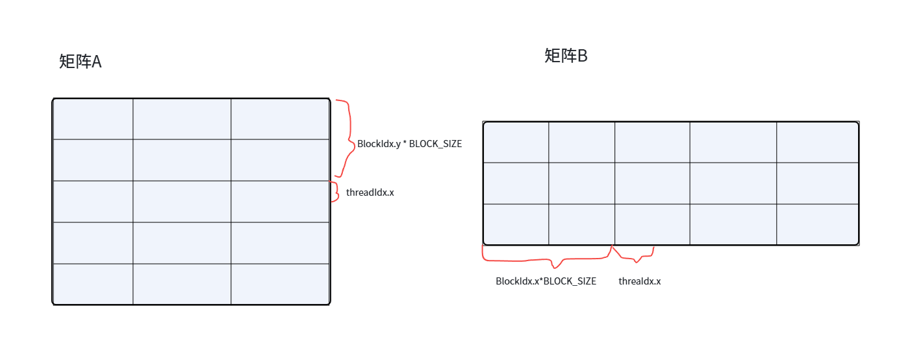
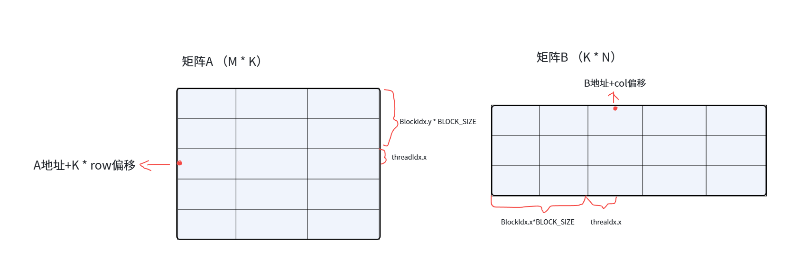
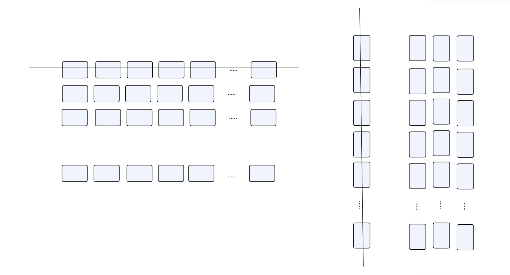

### 实现步骤

在 `gemm_naive` 版本中，计算 C 矩阵（M x N）一共需要 MxN 个线程来进行计算，但在计算过程中线程并没有使用 shared memory，各个线程进行计算都是从 global memory 中加载数据。而在 `gemm_tile` 中，将大规模的矩阵运算拆分成一个个 tile，一个 block 只负责一个 tile。

#### 计算位置坐标

设置模板参数 `BLOCK_SIZE` 为我的 tile 的边长，矩阵 A 为 M x K，矩阵 B 为 K x N，矩阵 C 为 M x N，一个 block 用来处理矩阵 A 维度 M 上的一个 tile 与矩阵 B 维度 N 上的一个 tile，所以通过 `blockIdx.x * BLOCK_SIZE` 与 `blockIdx.y * BLOCK_SIZE` 来计算这两个 tile 的绝对地址。

后面各自加上 threadIdx 信息，就计算出来 block 中的这个线程负责的是这个 tile 的哪一横与哪一列。这个 row 与 col 也是最后计算结果中矩阵 C 的位置。

```cpp
int row = BLOCK_SIZE * blockIdx.y + threadIdx.y;
int col = BLOCK_SIZE * blockIdx.x + threadIdx.x;
```



根据 thread 信息，求出来我们要计算的 tile 后，要得到这两个 tile 的地址，方便后面我们从全局内存搬运到共享内存。从 A 加上 `K * row` 个元素后，得到这一行 tile 的绝对起始地址，从 B 加上 `col` 个元素后得到这一列 tile 的绝对起始地址。

```cpp
const float* BLOCK_A = A + K * row;
const float* BLOCK_B = B + col;
```



#### 申请共享内存

申请两个 `BLOCK_SIZE * BLOCK_SIZE` 大小的共享内存，分别存放矩阵 A 与矩阵 B 中 tile 的数据。并给每个 thread 中定义一个寄存器来存放后期的计算结果。

```cpp
__shared__ float TILE_A[BLOCK_SIZE * BLOCK_SIZE];
__shared__ float TILE_B[BLOCK_SIZE * BLOCK_SIZE];
float sum = 0.0f;
```

#### 搬运数据

矩阵 A 有 K 列，矩阵 B 有 K 行，tile 方向的维度大小都是 K，每次处理一个 tile，增量为一个 tile 的大小 `BLOCK_SIZE`。

把矩阵 A 的数据搬运到共享内存 `TILE_A` 时，先检查各个 thread 对应的 row 是否超过 M 行，`k + threadIdx.x` 是否超过 K 列，如果在这个范围内，利用上面计算出来的 tile 的起始地址 `BLOCK_A`，加上 `k + threadIdx.x` 偏移，就得到全局内存上要搬运的矩阵 A 地址。

把矩阵 B 上的数据搬运到共享内存 `TILE_B` 时，也是先检查 col 是否超过 N 列，`k + threadIdx.y` 是否超过 K 行，如果在这个范围内，利用上面计算出来的 tile 这一列的起始地址 `BLOCK_B`，加上 `(k + threadIdx.y) * N` 偏移来得到全局内存上要搬运的矩阵 B 地址。

> **注：** 这里计算 `BLOCK_B` 的偏移量时，这里好像直接 `(k + threadIdx.y) * N` 跨整整一行，怎么没有体现选中这一行的哪一个元素？
> 我们正在计算 `BLOCK_B` 的起始地址时，采用的是：`BLOCK_B = B + col`，里面这个 col 就包含 `threadIdx.x`，每一个线程的数据因为 `threadIdx.x` 不同从而搬运不同的位置。

后面用 `__syncthreads()` 保证共享内存数据搬运完成。

```cpp
for (int k = 0; k < K; k += BLOCK_SIZE) {
    if (row < M && (k + threadIdx.x) < K) {
        TILE_A[threadIdx.y * BLOCK_SIZE + threadIdx.x] = BLOCK_A[k + threadIdx.x];
    } else {
        TILE_A[threadIdx.y * BLOCK_SIZE + threadIdx.x] = 0.0f;
    }

    if (col < N && (k + threadIdx.y) < K) {
        TILE_B[threadIdx.y * BLOCK_SIZE + threadIdx.x] = BLOCK_B[(k + threadIdx.y) * N];
    } else {
        TILE_B[threadIdx.y * BLOCK_SIZE + threadIdx.x] = 0.0f;
    }
    __syncthreads();
    
    // 计算部分
}
```

#### 计算部分

跟之前 `gemm_naive` 计算部分一样，每一个线程负责矩阵 C 中的一个部分。

```cpp
#pragma unroll
for (int i = 0; i < BLOCK_SIZE; ++i) {
    sum += TILE_A[threadIdx.y * BLOCK_SIZE + i] * TILE_B[i * BLOCK_SIZE + threadIdx.x];
}
__syncthreads();
```



根据矩阵计算公式算出结果。

```cpp
if (row < M && col < N) {
    C[row * N + col] = alpha * sum + beta * C[row * N + col];
}
```