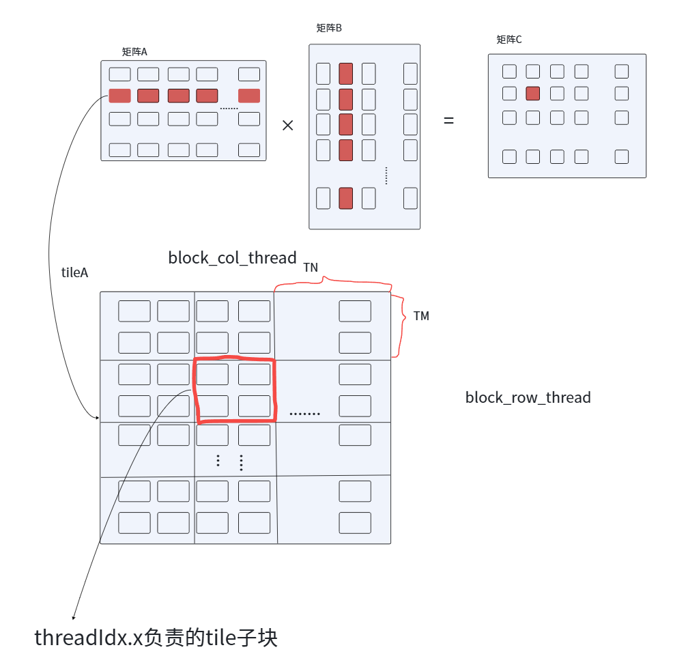
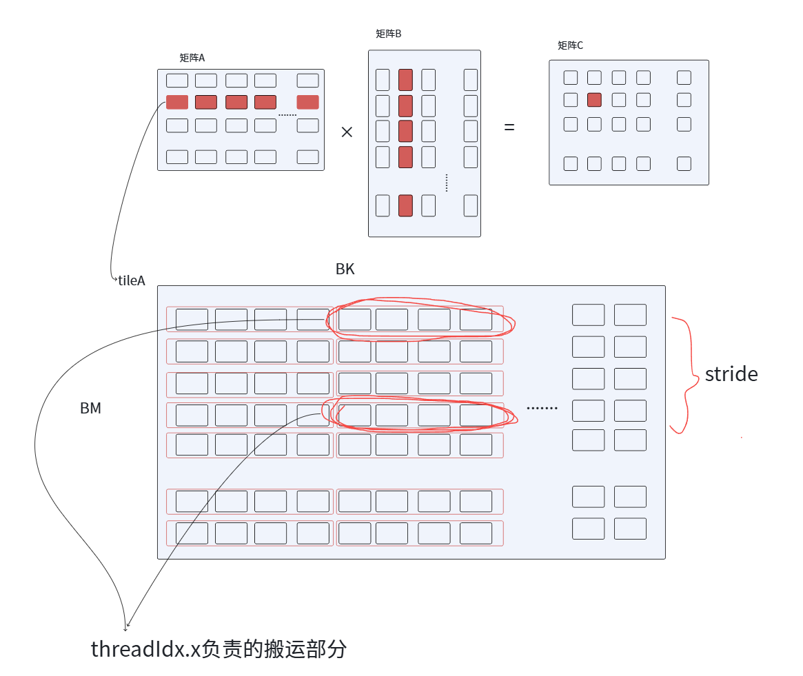
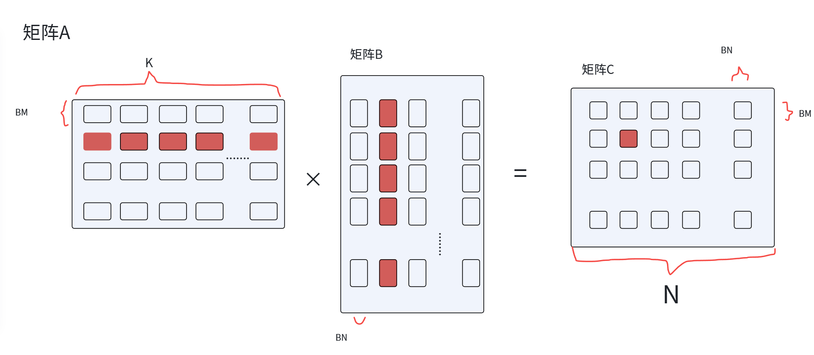
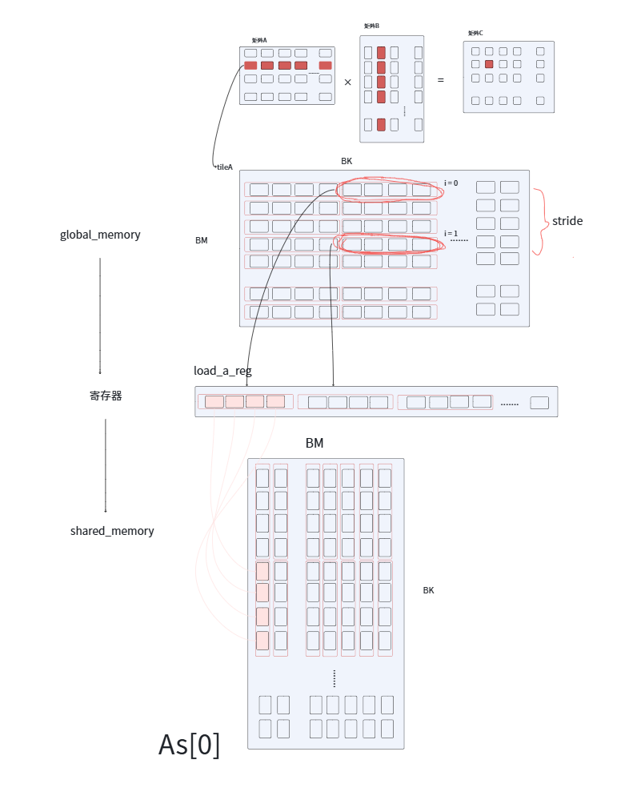
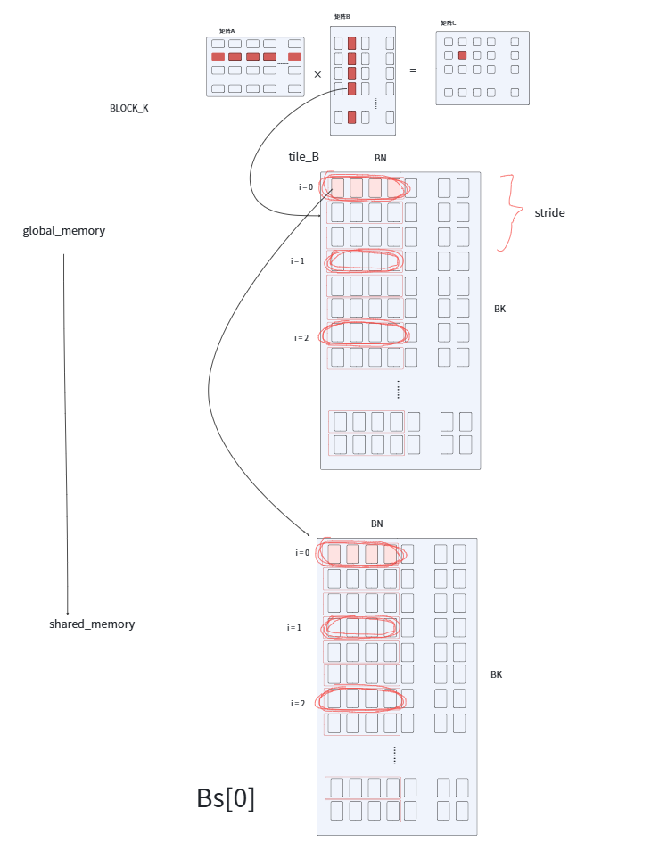
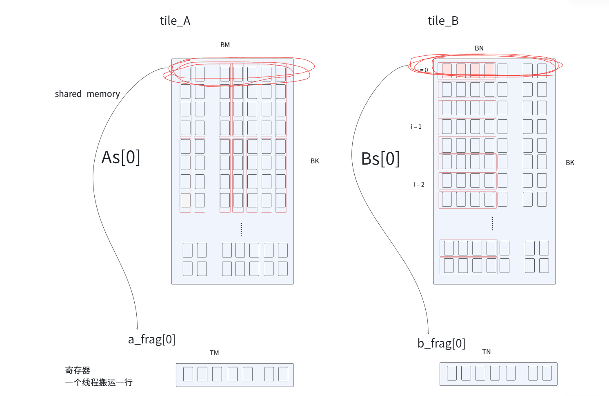
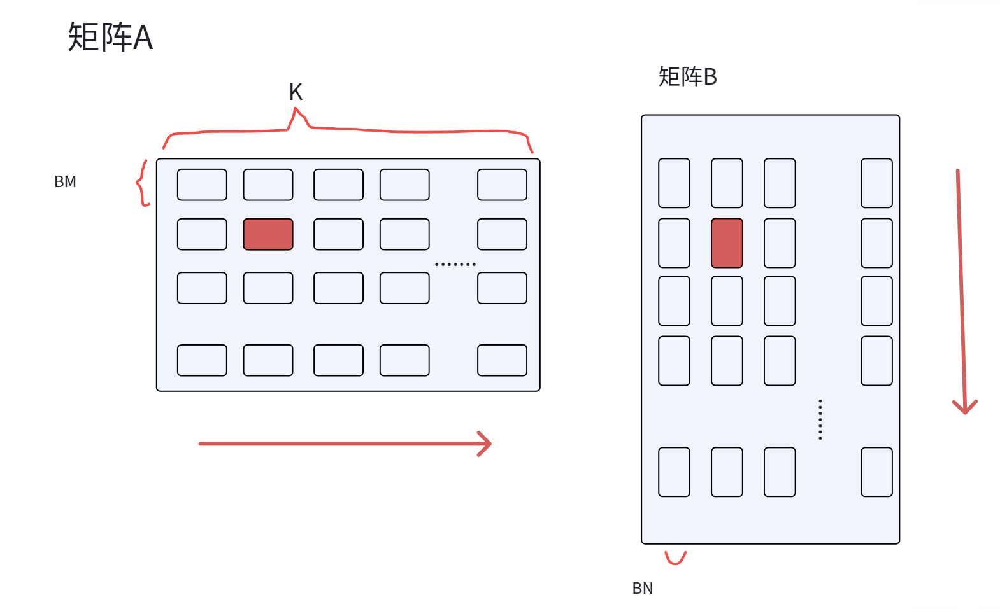
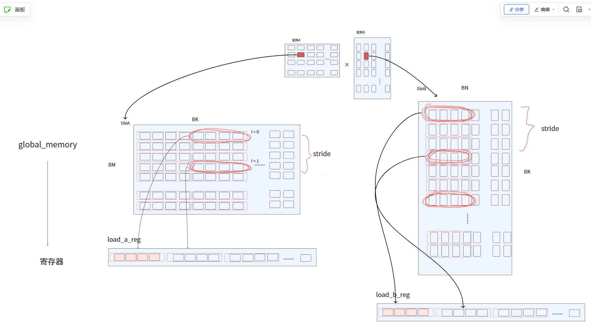
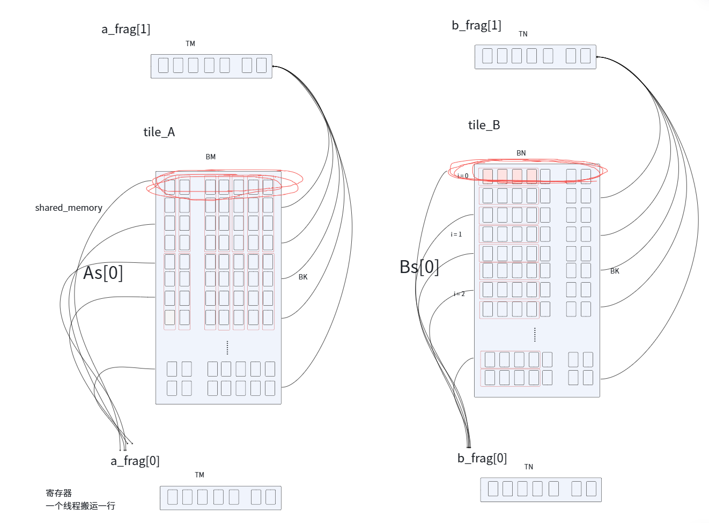
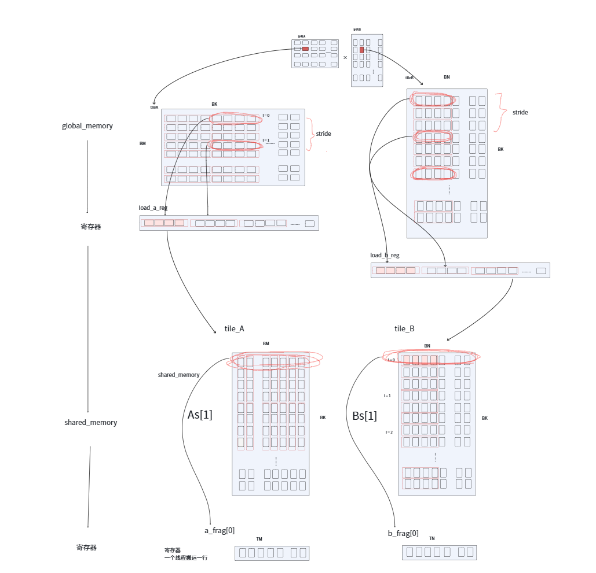

### 讲解

#### 函数参数

```cpp
BM、BN、BK为tile的M、N、K参数
TM、TN为单个thread负责的C的tile行数、列数

#define OFFSET(row, col, ld) ((row) * (ld) + (col))                      // 将二维坐标转化为一维索引
#define FETCH_FLOAT4(pointer) (reinterpret_cast<float4*>(&(pointer))[0]) // 将普通float指针转化为float4指针并进行解引用，一次读取或写入4个float
```

#### 函数流程

一个 block 负责一个 tile，block 中的 thread 负责一部分数据，并且共享内存与寄存器中分别存有两部分的数据，一部分用来计算当前的 FMA，另一部分用来存储下一次 FMA 所用的数据。

一个 block 负责一个 tile，一个 tile 有 BM 行，BN 列，block中的thread负责tile的一部分数据，行为 TM、列为 TN，所以要处理一个tile的一行需要 `BN / TN` 个thread，处理tile一列需要 `BM / TM` 个thread。所以一共需要 `BN / TN * BM / TM` 个thread。

```cpp
// m,n方向上的tile坐标
int bx = blockIdx.x;
int by = blockIdx.y;

const int block_col_thread = BM / TM;       // 一个block一列有多少thread
const int block_row_thread = BN / TN;       // 一个block一行有多少thread
const int thread_num = block_col_thread * block_row_thread; // 一个block一共有多少thread
```

处理一个 tile 一行需要 `block_row_thread` 个线程、一列需要 `block_col_thread` 个线程，此时可以利用当前线程的 `threadIdx` 来求出此线程负责的 sub_tile 的坐标，之后再从x方向、y方向上分别乘一个 sub_tile 的行、列就可以求出这个 sub_tile 相对与 tile 的相对坐标。

```cpp
// 当前thread负责的sub_tile坐标
int tx = (threadIdx.x % block_row_thread) * TN;
int ty = (threadIdx.x / block_row_thread) * TM;
```



矩阵 A 一个 tile 中有 `BM * BK` 个数据，矩阵 B 的 tile 有 `BK * BN` 个数据，有 `thread_num` 个线程来处理这些 tile，所以矩阵 A 的一个 tile 中每一个 thread 要搬运 `BM * BK / thread_num / 4` 次，矩阵 B 的一个 tile 中每一个 thread 要搬运 `BK * BN / thread_num / 4` 次。（采用 float4 类型搬运，一个从搬运4个，最后再 ÷4）。

```cpp
// 每个tile中每个thread要搬多少次
const int ldg_a_num = (BM * BK) / thread_num / 4;
const int ldg_b_num = (BK * BN) / thread_num / 4;
```

申请共享内存，用来存放全局内存中一个 tile 搬运来的数据，As 的大小为 tile_A 的大小，Bs 的大小为 tile_B 的大小。但这里用到双缓存，一个用来存放正在计算的数据，一个用来存放下轮提前加载的数据。

```cpp
/*
设置shared memory双缓存
As[0]/Bs[0]: 当前正在计算的数据
As[1]/Bs[1]: 下一轮提前加载的数据
*/
__shared__ float As[2][BM * BK];
__shared__ float Bs[2][BK * BN];
```

上面计算出来 thread 负责的 sub_tile 的坐标后，还要计算 thread 要搬运数据的位置，因为要搬运的数据类型是 float4，一个 tile(矩阵A) 一行有 BN 个数据（注：此处原文笔误，矩阵A一行应该是 BK），一列有 BM 个数据，所以用 float4 替换后，一个 tile 一行有 `BK / 4` 个搬运单元，一列由 `BM / 4` 个搬运单元。

用当前 thread 的 `threadIdx.x / (BK / 4)`，向下取整，得到要搬运数据的“行位置”，用 `threadIdx.x % (BK / 4)` 求出要搬运数据的“列位置”，但一个搬运单元有4个 float，所以在计算实际相对位置时还要 `* 4`。

为了合并访存，每一个线程要连续访问提高效率，thread 读取数据后要“跳跃”一部分数据才能继续搬运。我们在上一步计算出来每一个 thread 要搬运 `ldg_a_num` 次，矩阵 A 在 x 方向上搬运，一共 BM 个数据，每隔 `BM / ldg_a_num` 个数据进行搬运。

矩阵 B 同理。

```cpp
// 当前thread负责的sub_tile在矩阵A的位置
int a_tile_row = threadIdx.x / (BK / 4);
int a_tile_col = threadIdx.x % (BK / 4) * 4;
int a_tile_stride = BM / ldg_a_num;             // 当前线程搬运矩阵A数据时的步长

// 当前thread负责的sub_tile在矩阵B的位置
int b_tile_row = threadIdx.x / (BN / 4);
int b_tile_col = threadIdx.x % (BN / 4) * 4;
int b_tile_stride = BK / ldg_b_num;             // 当前线程搬运矩阵B数据时的步长
```



定义两组寄存器，分别用在从 shared memory 中取出来的数据放到此寄存器中，用于后面的 FMA 计算，`frag[0]` 用来存放当前计算的数据，`frag[1]` 负责下一轮的计算。

```cpp
/*
使用双buffer
a_frag[0]负责当前计算
a_frag[1]负责下一轮计算
*/
float a_frag[2][TM];
float b_frag[2][TN];
```

定义两个寄存器，用来存放从 global memory 搬运到 shared memory 途中的中转站。

```cpp
/*
global_memory搬运到shared_memory途中的中转站 global_memory--->register--->shared_memory
*/
float ldg_a_reg[4 * ldg_a_num] = {0.0f};
float ldg_b_reg[4 * ldg_b_num] = {0.0f};
```

上面算出来的 sub_tile 的位置，搬运数据位置都是相对于 tile 来说的，我们要算绝对地址。

计算矩阵 A 中 tile 的位置时，矩阵 A 一行有 K 个元素，一个 block 对应一行，用 `blockIdx.y * BM` 计算出有多少行，两者结合就求出 tile 在 A 中的坐标。
计算矩阵 B 中 tile 的位置时，一个 block 对应一列，用 `blockIdx.x * BN` 就算出 tile 在矩阵 B 的坐标。
计算矩阵 C 中 tile 的位置时，矩阵 C 一行有 N 个元素，一个 block 对应一个 tile，用 `blockIdx.y * BM` 计算出来有多少行，在 ×N 就算出来这些行一共有多少元素，再用 `blockIdx.x * BN` 计算出来这个 tile 前面有多少列。

```cpp
// 当前block对应的区域
A = &A[by * BM * K];
B = &B[bx * BN];
C = &C[by * BM * N + bx * BN];
```



第一次加载 tile_A，一共 BM 行，每一个线程每次隔 `a_tile_stride` 搬一次数据，所以对于矩阵 A 的数据搬运循环应该为 `for (int i = 0; i < BM; i += a_tile_stride)`。因为我们是4个float数据一起搬，所以在知道批次（`i / a_tile_stride`）的情况下，还要乘4来得到数据的存放位置 `(i / a_tile_stride) * 4`。先从全局内存矩阵 A 中读取数据，放入临时寄存器 `ldg_a_reg` 中，再从寄存器中把数据搬运到共享内存 `shared_A` 中。

```cpp
/*
第一次加载tile_A
*/
#pragma unroll
for (int i = 0; i < BM; i += a_tile_stride) {
    
    // 从global_memory --> register
    int ldg_index = (i / a_tile_stride) * 4;
    FETCH_FLOAT4(ldg_a_reg[ldg_index]) = FETCH_FLOAT4(A[OFFSET(a_tile_row + i, a_tile_col, K)]);

    // 从register --> shared memory,转置存入
    As[0][OFFSET(a_tile_col, a_tile_row + i, BM)] = ldg_a_reg[ldg_index];
    As[0][OFFSET(a_tile_col + 1, a_tile_row + i, BM)] = ldg_a_reg[ldg_index + 1];
    As[0][OFFSET(a_tile_col + 2, a_tile_row + i, BM)] = ldg_a_reg[ldg_index + 2];
    As[0][OFFSET(a_tile_col + 3, a_tile_row + i, BM)] = ldg_a_reg[ldg_index + 3];
}
```



```cpp
/*
第一次加载tile_B
*/
#pragma unroll
for (int i = 0; i < BK; i += b_tile_stride) {
    // global memory --> shared memory
    FETCH_FLOAT4(Bs[0][OFFSET(b_tile_row + i, b_tile_col, BN)]) = 
    FETCH_FLOAT4(B[OFFSET(b_tile_row + i, b_tile_col, N)]);
}
```



保证第一次写入完成。

```cpp
// 保证第一次写入完成。
__syncthreads();
```

此时一个 tile 中的数据全都搬运到 `shared_memory[0]` 了，共享内存 `shared_A` 与 `shared_B` 都是按 BK 维度进行循环的，在分别从 `shared_A` 与 `shared_B` 中读取数据到各自的寄存器 `a_frag` 与 `b_frag` 中。但此时只从 shared memory 中取了第一行数据放到了各自的寄存器 `frag[0]` 中。

```cpp
// 后续从shared_memory --> register
#pragma unroll
for (int m = 0; m < TM; m += 4) {
    FETCH_FLOAT4(a_frag[0][m]) = FETCH_FLOAT4(As[0][OFFSET(0, ty + m, BM)]);
}
#pragma unroll
for (int n = 0; n < TN; n += 4) {
    FETCH_FLOAT4(b_frag[0][n]) = FETCH_FLOAT4(Bs[0][OFFSET(0, tx + n, BN)]);
}
```



设置两个标志位，分别用来标记 `shared_memory` 和 `register` 是用来计算还是用来存储的。将 `write_index` 设置为1。我们在 `global_memory` 中无论是矩阵 A 还是矩阵 B，都是从K维度来遍历的，因为 `tile_0` 在之前已经存入到 `shared_memory[0]` 中。所以这里直接从 `k = BK, tile_1` 开始。

```cpp
int write_index = 1;
int load_index;
int k = 0;
do {
    k += BK;

    // double buffer
    
} while (k < K);
```



当这个 k 还在矩阵维度 K 之内时，像之前一样，还是将 global memory 上的数据加载到 `ldg_reg` 寄存器上，此时矩阵 B 也不直接往 `shared_memory` 上搬运数据，也借助寄存器。

```cpp
if (k < K) {
    #pragma unroll
    for (int i = 0; i < BM; i += a_tile_stride) {
        int ldg_index = (i / a_tile_stride) * 4;
        FETCH_FLOAT4(ldg_a_reg[ldg_index]) = FETCH_FLOAT4(A[OFFSET(a_tile_row + i, a_tile_col + k, K)]);
    }
    #pragma unroll
    for (int i = 0; i < BK; i += b_tile_stride) {
        int ldg_index = (i / b_tile_stride) * 4;
        FETCH_FLOAT4(ldg_b_reg[ldg_index]) = FETCH_FLOAT4(B[OFFSET(b_tile_row + k + i, b_tile_col, N)]);
    }
}
```



现在“写标识符” `write_index` 为1，计算标识符 `load_index` 应该时刻与它相反，计算数据与加载数据不冲突，达到双缓存的效果。

```cpp
// 获取当前的计算buffer
load_index = write_index ^ 1;
```

我们之前在 `shared_memory[0]` 中已经加载了 `tile_0` 的数据，并把 `shared_memory[0]` 的第一行数据放到了 `frag[0]` 中，这时我们就计算 `shared_memory[0]` 的其他行数据放入寄存器 `frag[0]` 中便于后面的 FMA（`load_index` 异或后也是0）。

此时遍历的维度还是 BK 方向上的，因为我们之前已经把 `shared_memory[0]` 的第一行数据加载到寄存器 `frag[0]` 中，所以遍历的次数就减少一次 `for (int bk = 0; bk < BK - 1; bk++)`。

后面我们取第一行数据时，要放到 `frag[1]` 中，不要与 `frag[0]` 的数据冲突。这里，我们在从 shared memory[0] 中往 frag 寄存器搬运数据时，以及寄存器去做FMA时是通过 `(bk + 1) % 2` 与 `bk % 2` 来避免冲突的。比如此时 `frag[0]` 中的数据用来做FMA，那么搬运数据就用 `frag[1]`，下一轮循环时就用 `frag[0]` 来搬运数据，用 `frag[1]` 中的数据来做FMA。

```cpp
// 在内存BK循环，shared_memory --> register --> FMA
#pragma unroll
for (int bk = 0; bk < BK - 1; bk++) {
    
    #pragma unroll
    for (int m = 0; m < TM; m += 4) {
        FETCH_FLOAT4(a_frag[(bk + 1) % 2][m]) = FETCH_FLOAT4(As[load_index][OFFSET(bk + 1, ty + m, BM)]);
    }

    #pragma unroll
    for (int n = 0; n < TN; n += 4) {
        FETCH_FLOAT4(b_frag[(bk + 1) % 2][n]) = FETCH_FLOAT4(Bs[load_index][OFFSET(bk + 1, tx + n, BN)]);
    }

    // 在当前bk里面进行FMA
    #pragma unroll
    for (int m = 0; m < TM; m++) {
        #pragma unroll
        for (int n = 0; n < TN; n++) {
            accum[m][n] += a_frag[bk % 2][m] * b_frag[bk % 2][n];
        }
    }
}
```



此时 `tile_0` 的数据（`shared_memory[0]`）已经处理完了，并且 `tile_1` 的数据已经放到 `ldg_a_reg` 与 `ldg_b_reg` 寄存器中，现在把 `ldg_a_reg` 与 `ldg_b_reg` 加载到 `shared_memory[1]` 中，`__syncthreads()` 同步之后，也是只将 `shared_memory[1]` 的第一行数据放到 `frag[0]` 中。在进入下一次循环时，就会处理 `tile_1` 的数据，并把 `tile_2` 的数据也进行处理，以此类推。

```cpp
/*
把下一个tile写入另一个shared buffer
*/
if (k < K) {
    #pragma unroll
    for (int i = 0; i < BM; i += a_tile_stride) {
        int ldg_index = (i / a_tile_stride) * 4;
        As[write_index][OFFSET(a_tile_col, a_tile_row + i, BM)] = ldg_a_reg[ldg_index];
        As[write_index][OFFSET(a_tile_col + 1, a_tile_row + i, BM)] = ldg_a_reg[ldg_index + 1];
        As[write_index][OFFSET(a_tile_col + 2, a_tile_row + i, BM)] = ldg_a_reg[ldg_index + 2];
        As[write_index][OFFSET(a_tile_col + 3, a_tile_row + i, BM)] = ldg_a_reg[ldg_index + 3];
    }
    #pragma unroll
    for (int i = 0; i < BK; i += b_tile_stride) {
        int ldg_index = (i / b_tile_stride) * 4;
        FETCH_FLOAT4(Bs[write_index][OFFSET(b_tile_row + i, b_tile_col, BN)]) = 
        FETCH_FLOAT4(ldg_b_reg[ldg_index]);
    }

    __syncthreads();

    /*
    读取新的shared_memory --> register
    */
    #pragma unroll
    for (int m = 0; m < TM; m += 4) {
        FETCH_FLOAT4(a_frag[0][m]) = FETCH_FLOAT4(As[write_index][OFFSET(0, ty + m, BM)]);
    }
    #pragma unroll
    for (int n = 0; n < TN; n += 4) {
        FETCH_FLOAT4(b_frag[0][n]) = FETCH_FLOAT4(Bs[write_index][OFFSET(0, tx + n, BN)]);
    }
}
```



前面的循环 `for (int bk = 0; bk < BK - 1; bk++)` 中，加载数据是 `bk+1`，通过循环能把所有的数据都加载到寄存器中，但在后面的 FMA 中，使用的 `bk` 的数据，意味着没有将 `BK-1` 块的数据进行 FMA 运算。所以这里要单独处理一下最后一个 BK 的数据。

```cpp
/*
处理BK的最后一个元素
*/
#pragma unroll
for (int m = 0; m < TM; m++) {
    #pragma unroll
    for (int n = 0; n < TN; n++) {
        accum[m][n] += a_frag[(BK - 1) % 2][m] * b_frag[(BK - 1) % 2][n];
    }
}
```

后面记着将“写标识符” `write_index` 进行异或取反，保证下一次循环加载数据在 `shared_memory[0]` 中，计算数据在 `shared_memory[1]` 中。

```cpp
write_index ^= 1;
```

最后，将寄存器 `accum` 的结果写回全局内存中。

```cpp
/*
写回结果
*/
#pragma unroll
for (int m = 0; m < TM; m++) {
    for (int n = 0; n < TN; n += 4) {
        float4 c_val = FETCH_FLOAT4(C[OFFSET(ty + m, tx + n, N)]);
        c_val.x = alpha * accum[m][n] + beta * c_val.x;
        c_val.y = alpha * accum[m][n + 1] + beta * c_val.y;
        c_val.z = alpha * accum[m][n + 2] + beta * c_val.z;
        c_val.w = alpha * accum[m][n + 3] + beta * c_val.w;

        FETCH_FLOAT4(C[OFFSET(ty + m, tx + n, N)]) = c_val;
    }
}
```