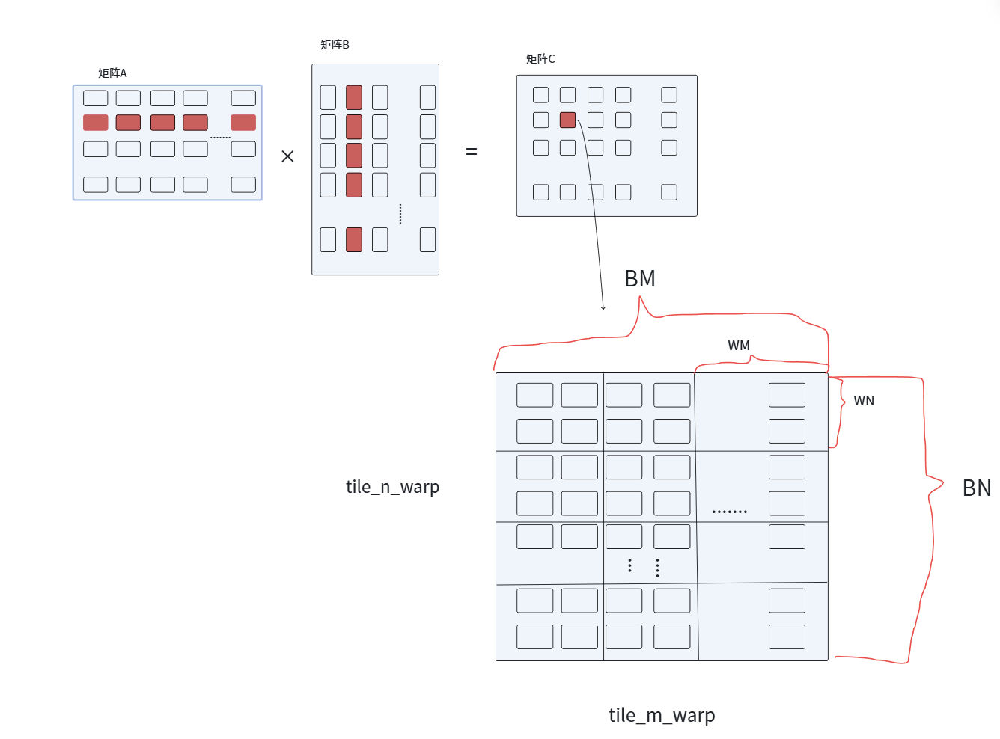
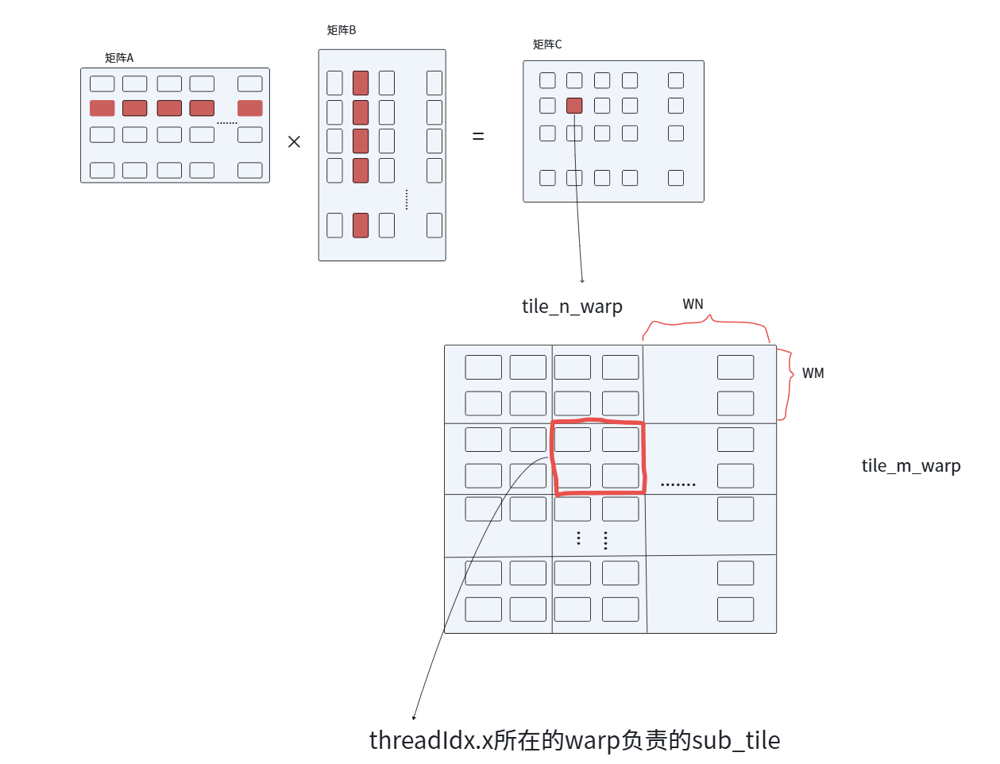
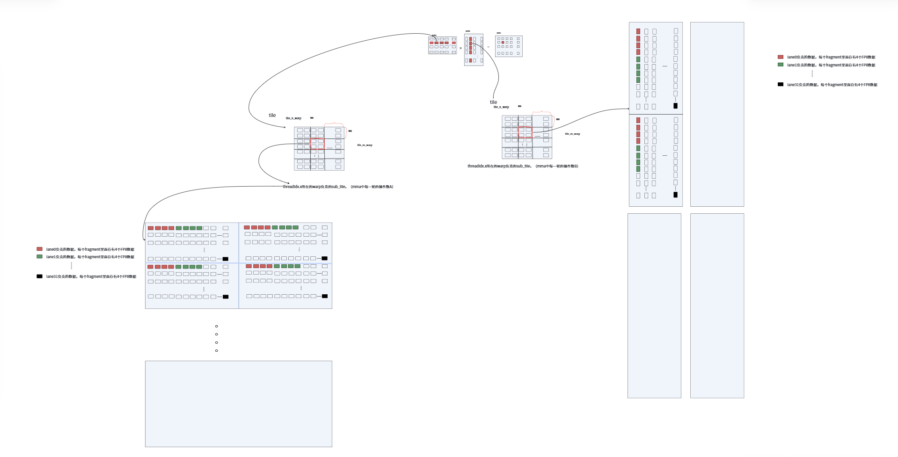
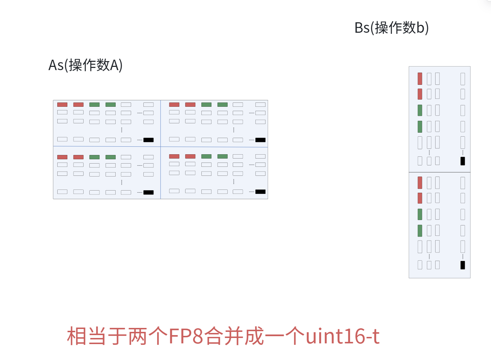
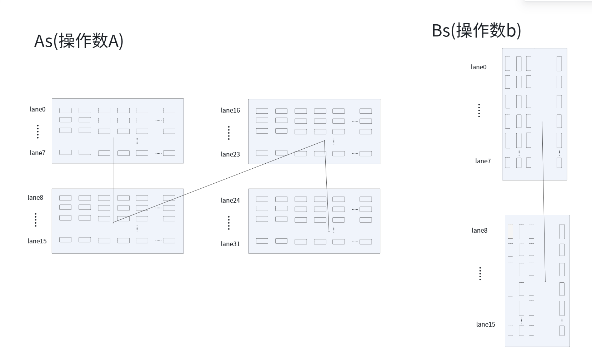
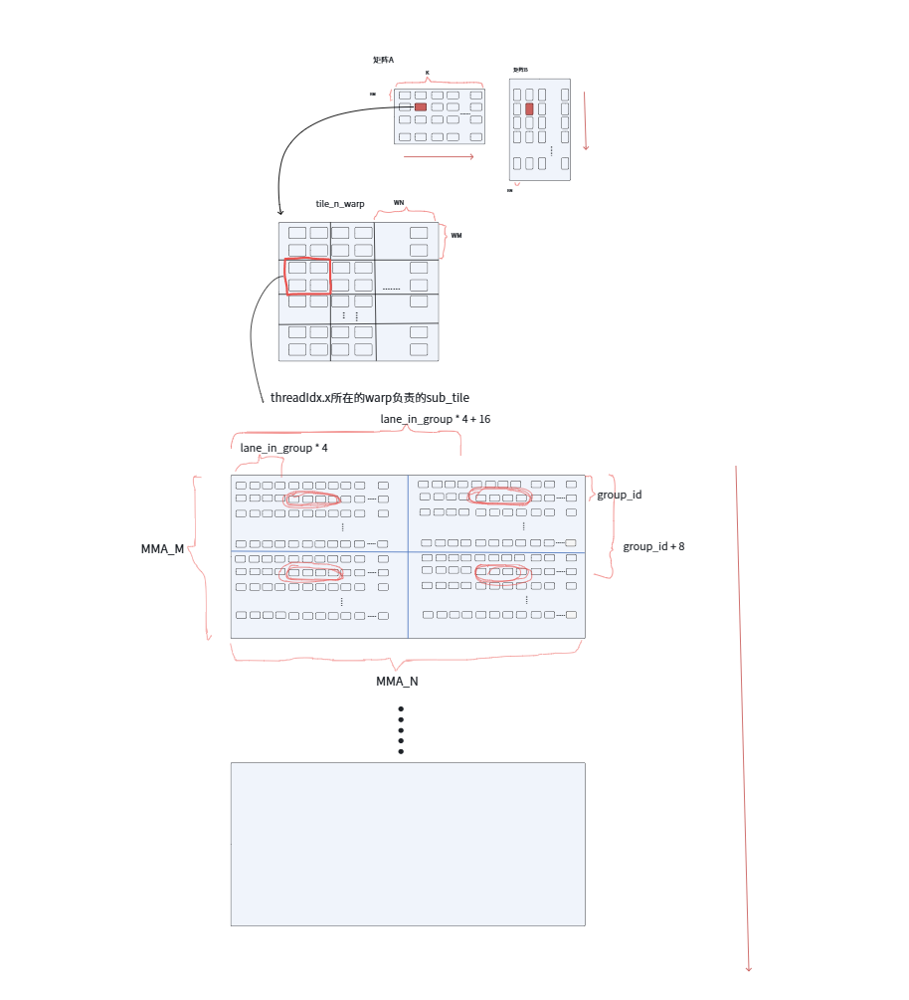
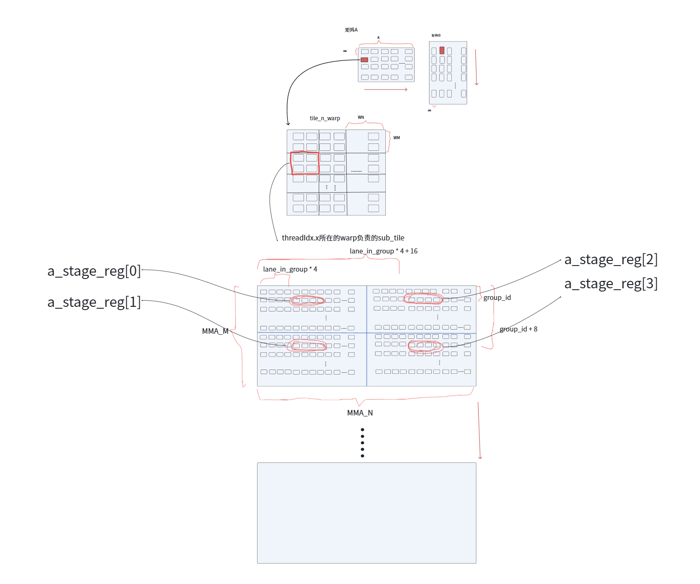
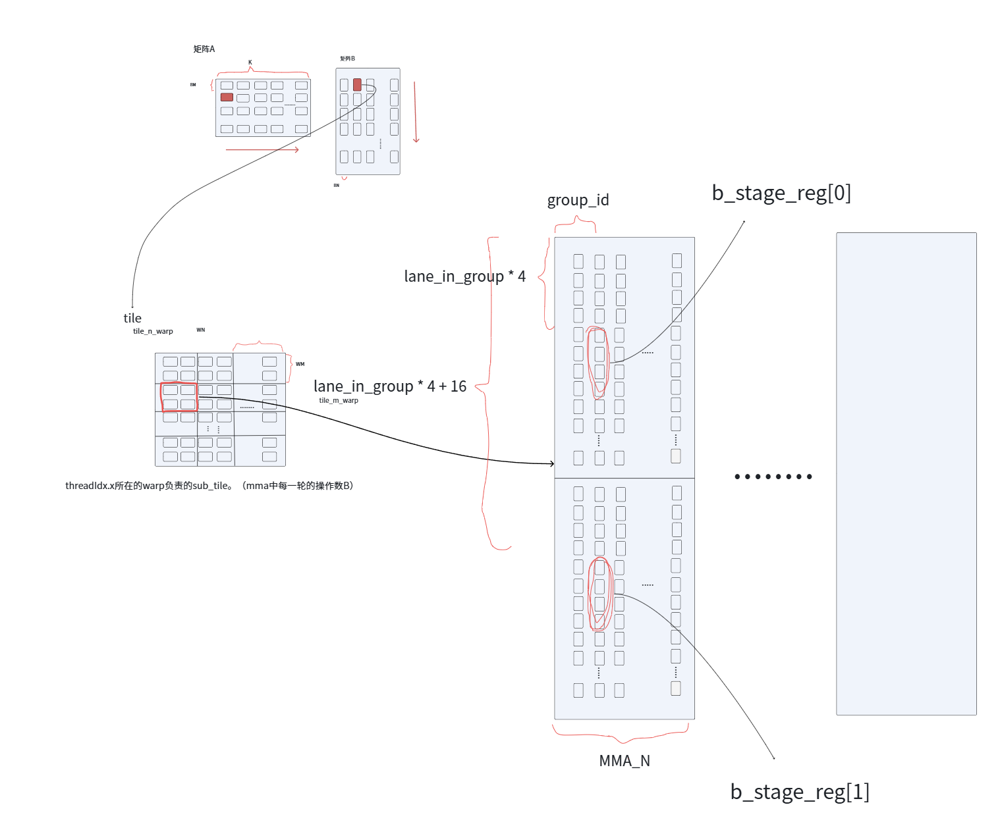
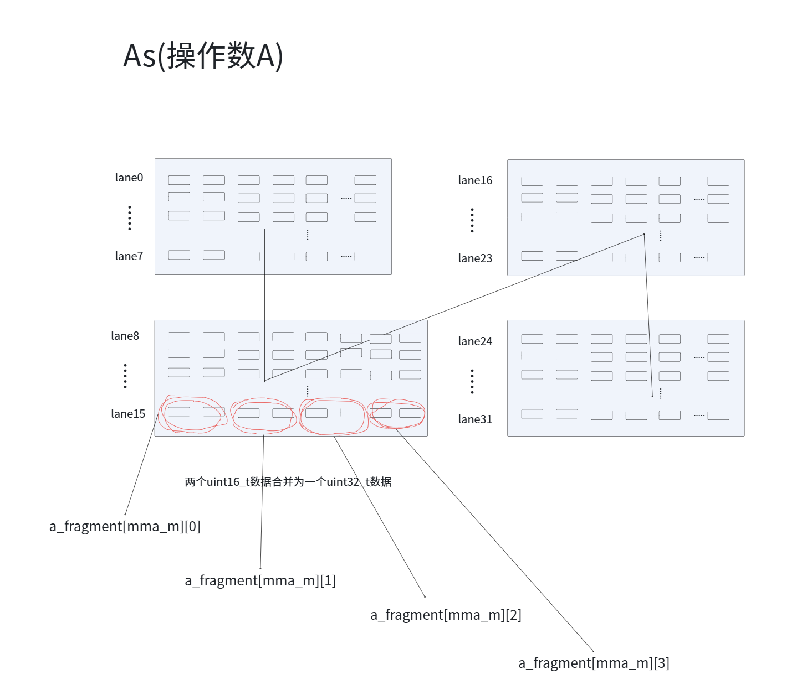
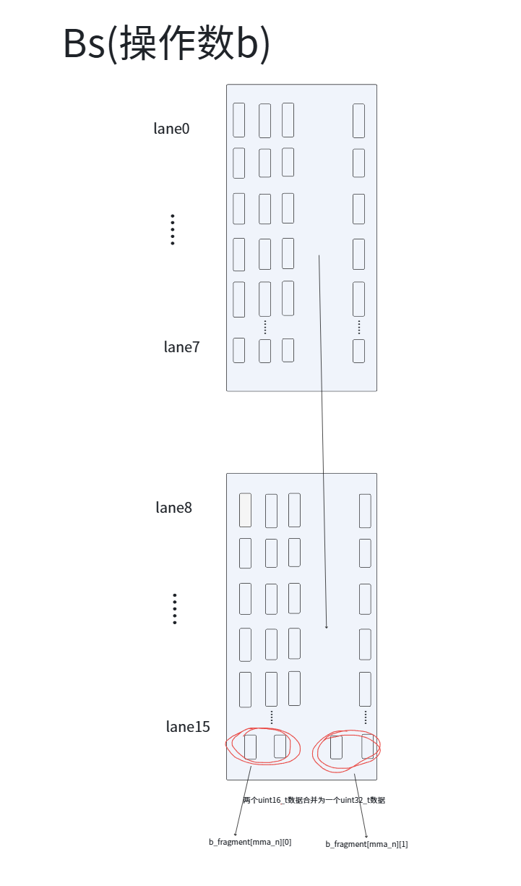

### 参数说明

```cpp
#define MMA_M 16                            // mma中一个warp的M方向的尺寸
#define MMA_N 8                             // mma中一个warp的N方向的尺寸
#define MMA_K 32                            // mma中一个warp的K方向的尺寸

template<const int BM, const int BN, const int BK>   // BM\BN\BK为一个tile处理的大小
```

### 代码流程

这里用mma指令来实现gemm的double buffer实现，这里还是让一个block负责一个大小为 `BM * BN * BK` 的 tile。因为warp指令是以warp为细粒度操作共享内存与寄存器的，所以这里用warp来负责block的一部分数据，尺度为WM、WN。

一个tile的M方向大小为BM，一个warp指令处理的m方向大小为WM，所以一个tile的M方向需要 `BM / WM` 个warp，同理一个tile的N方向需要 `BN / WN` 个warp。

所以处理一个tile一共需要 `BM / WM * BN / WN` 个warp

```cpp
const int tile_m_warp = BM / WM;            // 一个tile的m方向上有多少个warp
const int tile_n_warp = BN / WN;            // 一个tile的n方向上有多少个warp
const int warp_nums = tile_m_warp * tile_n_warp;        // 一个tile中有多少个warp
```



一个warp负责一个sub_tile,但每次mma执行只能处理 `MMA_M * MMA_N`,所以一个sub_tile在m方向与n方向分别要进行 `WM / MMA_M` 和 `WN / MMA_N` 次mma运算。

```cpp
const int warp_mma_m = WM / MMA_M;          // 一个warp 在m方向要做多少次mma
const int warp_mma_n = WN / MMA_N;          // 一个warp 在n方向要做多少次mma
```

无论是矩阵A还是矩阵B，tile的遍历都是K维度上进行的，sub_tile层面进行mma也是BK维度上进行的，一共BK个元素，一次mma处理的大小为 `MMA_K`，一共需要处理 `BK / MMA_K` 次。

```cpp
const int bk_steps = BK / MMA_K;
```

针对一个warp，一个warp里面有32个thread，我们要计算当前thread的束内线程编号以及当前thread所处的warp在整个block的标号。

束内线程编号lane通过当前的 `threadIdx.x % 32` 来获得（范围为0~31），当前warp在当前block中的编号则通过 `threadIdx.x / 32` 来获得（查看是“第几个32”，向下取整）。

```cpp
const int lane = threadIdx.x & 31;          // => threadIdx.x % 32，当前thread在warp中是
const int warp_id = threadIdx.x >> 5;       // => threadIdx.x / 32，当前thread所在的warp
```

处理一个tile一行需要 `tile_n_warp` 个warp，之前算出来的 `warp_id` 求出此warp所负责的sub_tile的坐标，`warp_id / tile_n_warp` 求出此warp在第几行，`warp_id % tile_n_warp` 求出此warp在这个sub_tile的第几列，之后再从m方向与n方向上乘一个 sub_tile 的行列就可以求出这个 sub_tile 相对于 tile 的相对坐标。

在这个相对坐标的基础上，m方向与n方向上分别加上 `blockIdx.y * BM` 与 `blockIdx.x * BN` 这个偏移（tile相当于矩阵的相对地址），最终求出来warp负责的sub_tile与矩阵C的绝对地址。

```cpp
// 当前warp负责的sub_tile的相对坐标
const int warp_m = (warp_id / tile_n_warp) * MMA_M;
const int warp_n = (warp_id % tile_n_warp) * MMA_N;

// 当前warp负责的sub_tile的全局坐标
const int warp_tile_m = blockIdx.y * BM + warp_m;
const int warp_tile_n = blockIdx.x * BN + warp_n;
```



我们使用的 `mma.sync.aligned.m16n8k32` 把warp分为8组，每组4个lane。（只是逻辑上分组，实际运行时还是要以整个warp的32个lane同步执行）。

> **题外话：**
> mma要处理的一个操作数A的大小为 `16 * 32 = 512` 个FP8数据，一个lane负责 `512 ÷ 32 = 16` 个FP8数据，一共16个Bytes，一个register可以容纳4个Bytes，因此一个lane需要 `16 ÷ 4 = 4` 个register。相当于把操作数A分成4个fragment。
>
> 同理，操作数B的大小为 `32 * 8 = 256` 个FP8数据，一个lane负责 `256 ÷ 32 = 8` 个FP8数据，一共8个字节，一个register可以容纳4个字节，因此一个lane需要 `8 ÷ 4 = 2` 个寄存器，相当于把操作数B分为2个fragment。



32 lanes = 8 groups x 4 lanes (由 `T0, T1, T2, T3` 为一组...)。

上面的计算与图示，操作数A的512个FP8数据分成了4个fragment，一个fragment有 `16/2=8` 行，每一行有4个lane，所以我们为了方便计算lane负责的数据地址，每一个warp分为8组，每组有4个lane，这是，我们就能根据lane计算出当前的束内线程负责的fragment的第几行（group），在当前group负责的第几列（lane_in_group）。具体的坐标计算过程后面会解释。

```cpp
const int group_id = lane >> 2;             // => lane / 4，当前lane是第几组
const int lane_in_group = lane & 3;         // => lane % 4，当前lane是这一组的第几个
```

申请tile_A与tile_B的共享内存As、Bs，其中这个共享内存有“4维”，第一维[2]代表双缓存，`shared_memory[0]` 表示正在计算的数据，`shared_memory[1]` 对应加载下一批的数据。第二维[warp_nums]表示当前warp的编号（一个block中不止一个warp，每个warp的数据要分开），第三维[bk_steps]表示第几个mma数据，第四维就代表当前sub_tile中第几轮mma。第5维就是存储的真实数据。

在一次mma中操作数的大小为512个FP8=256个 `uint16_t`，这里选用 `uint16_t` 这个数据类型，是因为后面的 `stmatrix` 指令与 `ldmatrix` 指令用的都是 `.sync.aligned.m8n8.x4.shared.b16`。而且一次加载4个fragment，这样算下来的话，用 `uint16_t` 存储数据就需要256个大小，同理操作数B用的共享内存大小为128。

```cpp
__shared__ __align__(16) uint16_t As[2][warp_nums][bk_steps][warp_mma_m][4 * 64];
__shared__ __align__(16) uint16_t Bs[2][warp_nums][bk_steps][warp_mma_n][2 * 64];
```



现在虽然申请了shared memory，但还要给 `stmatrix` 与 `ldmatrix` 计算shared memory的地址。无论是加载矩阵数据还是存储矩阵数据，都是一个lane负责一行的。比如lane0负责第0行，lane1负责第1行，以此类推，lane7负责第7行，然后下一个8-lane重新从row 0开始。所以用 `lane % 8` 计算当前的束内线程负责哪一行数据。

现在确定好lane要处理哪一行数据，但在操作数A中有4个fragment，怎么确定lane要负责第几个fragment呢？用 `lane / 8`，计算出来是“第几个8-row”。操作数B也是如此（操作数B只有两个8*8矩阵，所以最后要 `% 2`）。

```cpp
const int matrix_row = lane & 7;            // => lane % 8,
const int a_matrix_id = lane >> 3;          // => lane / 8
const int b_matrix_id = (lane >> 3) & 1;    // => (lane / 8) % 2
```



注意：B的shared memory行地址由lane 0~15提供，但所有的32个lane都会参与 `stmatrix` 与 `ldmatrix` 和 `mma`。

申请每个thread的累加寄存器。对于一条 `mma.sync.aligned.m16n8k32` 指令，计算出来的结果为 `16 * 8` 个 FP32数据，一个warp有32个lane，所以一个lane存放4个FP32数据。

```cpp
float accum[warp_mma_m][warp_mma_n][4] = {0.0f};
```

现在开始数据双缓存部分，首先，每一个warp负责将各自的第一个tile加载到 `shared memory[0]` 中。一个tile中要进行 `bk_steps` 次mma运算，所以对于矩阵A与矩阵B中的操作数，数据也要搬运 `bk_steps` 次。进行 `for (int bk_step = 0; bk_step < bk_steps; ++bk_step)` 循环。

这里每次搬运MMA_K个数据，所以根据自变量bk_step就可以得到当前的数据搬运位置。 `bk_step * MMA_K`

```cpp
for (int bk_step = 0; bk_step < bk_steps; ++bk_step) {
    const int global_k = bk_step * MMA_K;
    /*
    数据搬运部分
    */
}
__syncthreads();
```

在搬运矩阵A中的一个tile中一个warp负责的一个sub_tile时，一共要搬运 `warp_mma_m` 次，所以外层循环为 `for (int mma_m = 0; mma_m < warp_mma_m; ++mma_m)`。

之前我们计算过，一个lane要负责16个FP8数据，用共享内存存储也就是4个 `uint32_t` 数据，所以还要为每一个束内线程lane申请4个寄存器。

后面我们计算warp中的lane要搬运的fragment的位置。当前warp会往m方向进行m次搬运数据，一次搬运的维度为MMA_M，所以当前操作数A的起始地址为 `warp_tile_m + mma_m * MMA_M`。但一个操作数A有4个fragment。还要确定每一个fragment的坐标。之前计算的 `group_id` 把一个warp中的lane分为8组，第一组的4个lane负责fragment的第0行、第8行，第二组的4个lane负责fragment的第1行、第9行，以此类推。所以在计算fragment的m方向坐标时，要在操作数A的基础上 `+group_id`，`+group_id + 8`。fragment一行由4个lane负责，一个lane负责4个fp8数据，所以在原来列 `bk_step * MMA_K` 的基础上，`+lane_in_group * 4`，`lane_in_group * 4 + 16` 得到对应fragment的列坐标。

```cpp
uint32_t a_stage_reg[4];

// 计算当前fragment_A的16行起始地址。
const int mma_tile_m = warp_tile_m + mma_m * MMA_M;
const int a_row_0 = mma_tile_m + group_id;
const int a_row_1 = mma_tile_m + group_id + 8;
const int k_offset_0 = global_k + lane_in_group * 4;
const int k_offset_1 = k_offset_0 + 16;
```



之后知道了对应fragment的坐标，将对应数据存入到寄存器中。

```cpp
a_stage_reg[0] = *reinterpret_cast<const uint32_t*>(A + a_row_0 * K + k_offset_0);
a_stage_reg[1] = *reinterpret_cast<const uint32_t*>(A + a_row_1 * K + k_offset_0);
a_stage_reg[2] = *reinterpret_cast<const uint32_t*>(A + a_row_0 * K + k_offset_1);
a_stage_reg[3] = *reinterpret_cast<const uint32_t*>(A + a_row_1 * K + k_offset_1);
```



利用 `__cvta_generic_to_shared`，把之前的普通的C++指针转化为 `stmatrix` 与 `ldmatrix` 所需要的 shared memory 地址。

之后利用 `stmatrix` 指令，把之前在寄存器中保存的值存储到 shared memory 中。

```cpp
uint32_t a_shared_addr = static_cast<uint32_t>(__cvta_generic_to_shared(&As[0][warp_id][bk_step][mma_m][a_matrix_id * 64 + matrix_row * 8]));
asm volatile (
    "stmatrix.sync.aligned.m8n8.x4.shared.b16 "
    "[%0], {%1, %2, %3, %4};\n"
    :
    : "r"(a_shared_addr), "r"(a_stage_reg[0]), "r"(a_stage_reg[1]), "r"(a_stage_reg[2]), "r"(a_stage_reg[3])
    : "memory"
);
```

后面加载矩阵B上的操作数B也是相同的原理，这里就不再赘述，只给出代码与示意图。

```cpp
for (int mma_n = 0; mma_n < warp_mma_n; ++mma_n) {
    uint32_t b_stage_reg[2];

    const int mma_tile_n = warp_tile_n + mma_n * MMA_N;

    // B为列主序
    const int b_col = mma_tile_n + group_id;
    const int k_offset_0 = global_k + lane_in_group * 4;
    const int k_offset_1 = k_offset_0 + 16;

    // 打包到自己负责的寄存器中
    b_stage_reg[0] = *reinterpret_cast<const uint32_t*>(B + b_col * K + k_offset_0);
    b_stage_reg[1] = *reinterpret_cast<const uint32_t*>(B + b_col * K + k_offset_1);

    uint32_t b_shared_addr = static_cast<uint32_t>(__cvta_generic_to_shared(&Bs[0][warp_id][bk_step][mma_n][b_matrix_id * 64 + matrix_row * 8]));

    asm volatile (
        "stmatrix.sync.aligned.m8n8.x2.shared.b16 "
        "[%0], {%1, %2};\n"
        :
        : "r"(b_shared_addr), "r"(b_stage_reg[0]), "r"(b_stage_reg[1])
        : "memory"
    );
}
```



矩阵A与矩阵B的第0个tile已经提前放入到 `shared memory[0]` 中，现在处理其余的tile，外层循环为： `for (int block_k = 0; block_k < K - BK; block_k += BK)`

```cpp
for (int block_k = 0; block_k < K - BK; block_k += BK) {
    /*
    双缓存部分
    */
}
```

上一步中加载数据标志位 `load_buffer` 设置为0，在双缓存流水阶段，计算数据标志位 `write_buffer` 求要与之相反，进行异或操作，同时用 `next_block_k` 记录下一个要处理的tile。

```cpp
const int write_buffer = load_buffer ^ 1;
const int next_block_k = block_k + BK;
```

之前，我们已经把 `tile[0]` 的部分已经放到了对应的 `shared memory[0]` 中，所以，这里直接再次进行遍历，利用 `ldmatrix` 指令将 `shared memory[0]` 中的数据放到寄存器中。这里我们以矩阵A的操作数为例，一个tile中有 `warp_mma_m` 个mma操作，一次mma操作需要有4个寄存器，所以我们申请寄存器 `a_fragment[warp_mma_m][4]`。

注意，这里计算shared memory中的坐标时，我们要借助 `a_matrix_id` 与 `matrix_row` 这两个变量，操作数A中一个fragment有64个元素，`a_matrix_id*64` 表示当前lane负责的数据在共享内存的第几个fragment中，`matrix_row * 8` 表示在这个fragment中lane负责搬运的具体行数。

```cpp
#pragma unroll
for (int mma_m = 0; mma_m < warp_mma_m; ++mma_m) {

    uint32_t a_shared_addr = static_cast<uint32_t>(__cvta_generic_to_shared(&As[load_buffer][warp_id][bk_step][mma_m][a_matrix_id * 64 + matrix_row * 8]));

    asm volatile(
        "ldmatrix.sync.aligned.m8n8.x4.shared.b16 "
        "{%0, %1, %2, %3}, [%4];\n"
        : "=r"(a_fragment[mma_m][0]), "=r"(a_fragment[mma_m][1]), "=r"(a_fragment[mma_m][2]), "=r"(a_fragment[mma_m][3])
        : "r"(a_shared_addr)
        : "memory"
    );
}
```



关于矩阵B中的操作数B，与上面的过程类似，这里只给出对应的代码与示意图。

```cpp
uint32_t b_fragment[warp_mma_n][2];
#pragma unroll
for (int mma_n = 0; mma_n < warp_mma_n; ++mma_n) {
    uint32_t b_shared_addr = static_cast<uint32_t>(__cvta_generic_to_shared(&Bs[load_buffer][warp_id][bk_step][mma_n][b_matrix_id * 64 + matrix_row * 8]));

    asm volatile(
        "ldmatrix.sync.aligned.m8n8.x2.shared.b16 "
        "{%0, %1}, [%2];\n"
        : "=r"(b_fragment[mma_n][0]), "=r"(b_fragment[mma_n][1])
        : "r"(b_shared_addr)
        : "memory"
    );
}
```



到这一步，已经把 `tile[0]` 的数据全部转移到寄存器上了，方便后面调用mma指令直接进行计算。

下一步，将 `tile[1]` 的数据从 global memory 中转移到各个lane的寄存器中，地址计算跟 `tile[0]` 一致，此处不多赘述。

```cpp
uint32_t next_a_stage_reg[warp_mma_m][4];
uint32_t next_b_stage_reg[warp_mma_n][2];

const int next_k = next_block_k + bk_step * MMA_K;

#pragma unroll
for (int mma_m = 0; mma_m < warp_mma_m; ++mma_m) {
    const int mma_tile_m = warp_tile_m + mma_m * MMA_M;
    const int a_row_0 = mma_tile_m + group_id;
    const int a_row_1 = mma_tile_m + group_id + 8;
    const int k_offset_0 = next_k + lane_in_group * 4;
    const int k_offset_1 = k_offset_0 + 16;

    next_a_stage_reg[mma_m][0] = *reinterpret_cast<const uint32_t*>(A + a_row_0 * K + k_offset_0);
    next_a_stage_reg[mma_m][1] = *reinterpret_cast<const uint32_t*>(A + a_row_1 * K + k_offset_0);
    next_a_stage_reg[mma_m][2] = *reinterpret_cast<const uint32_t*>(A + a_row_0 * K + k_offset_1);
    next_a_stage_reg[mma_m][3] = *reinterpret_cast<const uint32_t*>(A + a_row_1 * K + k_offset_1);
}

#pragma unroll
for (int mma_n = 0; mma_n < warp_mma_n; ++mma_n) {
    const int mma_tile_n = warp_tile_n + mma_n * MMA_N;
    const int b_col = mma_tile_n + group_id;
    const int k_offset_0 = next_k + lane_in_group * 4;
    const int k_offset_1 = k_offset_0 + 16;

    next_b_stage_reg[mma_n][0] = *reinterpret_cast<const uint32_t*>(B + b_col * K + k_offset_0);
    next_b_stage_reg[mma_n][1] = *reinterpret_cast<const uint32_t*>(B + b_col * K + k_offset_1);
}
```

这一步将 `tile[0]` 在寄存器中的数据直接调用 `mma` 指令，结果放到accm寄存器中。

```cpp
#pragma unroll
for (int mma_m = 0; mma_m < warp_mma_m; ++mma_m) {
    #pragma unroll
    for (int mma_n = 0; mma_n < warp_mma_n; ++mma_n) {
        asm volatile(
            "mma.sync.aligned.m16n8k32."
            "row.col.f32.e4m3.e4m3.f32 "
            "{%0, %1, %2, %3}, "
            "{%4, %5, %6, %7}, "
            "{%8, %9}, "
            "{%0, %1, %2, %3};\n"
            : "+f"(accum[mma_m][mma_n][0]), "+f"(accum[mma_m][mma_n][1]), "+f"(accum[mma_m][mma_n][2]), "+f"(accum[mma_m][mma_n][3])
            : "r"(a_fragment[mma_m][0]), "r"(a_fragment[mma_m][1]), "r"(a_fragment[mma_m][2]), "r"(a_fragment[mma_m][3]), "r"(b_fragment[mma_n][0]), "r"(b_fragment[mma_n][1])
        );
    }
}
```

将刚才 `tile[1]` 在寄存器中的数据调用 `stmatrix` 指令加载到共享内存中，注意此时的共享内存为 `shared memory[1]`。

```cpp
#pragma unroll
for (int mma_m = 0; mma_m < warp_mma_m; ++mma_m) {
    uint32_t next_a_shared_addr = static_cast<uint32_t>(__cvta_generic_to_shared(&As[write_buffer][warp_id][bk_step][mma_m][a_matrix_id * 64 + matrix_row * 8]));

    asm volatile(
        "stmatrix.sync.aligned.m8n8.x4.shared.b16 "
        "[%0], {%1, %2, %3, %4};\n"
        :
        : "r"(next_a_shared_addr), "r"(next_a_stage_reg[mma_m][0]), "r"(next_a_stage_reg[mma_m][1]), "r"(next_a_stage_reg[mma_m][2]), "r"(next_a_stage_reg[mma_m][3])
        : "memory"
    );
}

#pragma unroll
for (int mma_n = 0; mma_n < warp_mma_n; ++mma_n) {
    uint32_t next_b_shared_addr = static_cast<uint32_t>(__cvta_generic_to_shared(&Bs[write_buffer][warp_id][bk_step][mma_n][b_matrix_id * 64 + matrix_row * 8]));

    asm volatile(
        "stmatrix.sync.aligned.m8n8.x2.shared.b16 "
        "[%0], {%1, %2};\n"
        :
        : "r"(next_b_shared_addr), "r"(next_b_stage_reg[mma_n][0]), "r"(next_b_stage_reg[mma_n][1])
        : "memory"
    );
}
```

一轮双缓存结束，线程同步，同时把标志位进行更新，防止矛盾。

```cpp
__syncthreads();
load_buffer = write_buffer;
```

因为上面的双缓存循环结束，我们只处理了最后一个tile：把数据从 global memory 搬运到 register，从 register 搬运到 shared memory，还没有从 shared memory 中取出数据放入寄存器并计算结果，所以要单独处理一下。

```cpp
#pragma unroll
for (int bk_step = 0; bk_step < bk_steps; ++bk_step) {
    uint32_t a_fragment[warp_mma_m][4];
    uint32_t b_fragment[warp_mma_n][2];

    #pragma unroll
    for (int mma_m = 0; mma_m < warp_mma_m; ++mma_m) {
        uint32_t a_shared_addr = static_cast<uint32_t>(__cvta_generic_to_shared(&As[load_buffer][warp_id][bk_step][mma_m][a_matrix_id * 64 + matrix_row * 8]));

        asm volatile(
            "ldmatrix.sync.aligned.m8n8.x4.shared.b16 "
            "{%0, %1, %2, %3}, [%4];\n"
            : "=r"(a_fragment[mma_m][0]), "=r"(a_fragment[mma_m][1]), "=r"(a_fragment[mma_m][2]), "=r"(a_fragment[mma_m][3])
            : "r"(a_shared_addr)
            : "memory");
    }

    #pragma unroll
    for (int mma_n = 0; mma_n < warp_mma_n; ++mma_n) {
        uint32_t b_shared_addr = static_cast<uint32_t>(__cvta_generic_to_shared(&Bs[load_buffer][warp_id][bk_step][mma_n][b_matrix_id * 64 + matrix_row * 8]));
        asm volatile(
            "ldmatrix.sync.aligned.m8n8.x2.shared.b16 "
            "{%0, %1}, [%2];\n"
            : "=r"(b_fragment[mma_n][0]), "=r"(b_fragment[mma_n][1])
            : "r"(b_shared_addr)
            : "memory");
    }

    #pragma unroll
    for (int mma_m = 0; mma_m < warp_mma_m; ++mma_m) {
        #pragma unroll
        for (int mma_n = 0; mma_n < warp_mma_n; ++mma_n) {
            asm volatile(
                "mma.sync.aligned.m16n8k32."
                "row.col.f32.e4m3.e4m3.f32 "
                "{%0, %1, %2, %3}, "
                "{%4, %5, %6, %7}, "
                "{%8, %9}, "
                "{%0, %1, %2, %3};\n"
                : "+f"(accum[mma_m][mma_n][0]), "+f"(accum[mma_m][mma_n][1]), "+f"(accum[mma_m][mma_n][2]), "+f"(accum[mma_m][mma_n][3])
                : "r"(a_fragment[mma_m][0]), "r"(a_fragment[mma_m][1]), "r"(a_fragment[mma_m][2]), "r"(a_fragment[mma_m][3]), "r"(b_fragment[mma_n][0]), "r"(b_fragment[mma_n][1])
            );
        }
    }
}
```

进行矩阵乘法，将结果写回全局内存。

```cpp
#pragma unroll
for (int mma_m = 0; mma_m < warp_mma_m; ++mma_m) {
    #pragma unroll
    for (int mma_n = 0; mma_n < warp_mma_n; ++mma_n) {
        const int c_row_0 = warp_tile_m + mma_m * MMA_M + group_id;
        const int c_row_1 = c_row_0 + 8;
        const int c_col_0 = warp_tile_n + mma_n * MMA_N + lane_in_group * 2;
        const int c_col_1 = c_col_0 + 1;

        const int c_index_0 = c_row_0 * N + c_col_0;
        const int c_index_1 = c_row_0 * N + c_col_1;
        const int c_index_2 = c_row_1 * N + c_col_0;
        const int c_index_3 = c_row_1 * N + c_col_1;

        if (beta != 0.0f) {
            accum[mma_m][mma_n][0] = alpha * accum[mma_m][mma_n][0] + beta * C[c_index_0];
            accum[mma_m][mma_n][1] = alpha * accum[mma_m][mma_n][1] + beta * C[c_index_1];
            accum[mma_m][mma_n][2] = alpha * accum[mma_m][mma_n][2] + beta * C[c_index_2];
            accum[mma_m][mma_n][3] = alpha * accum[mma_m][mma_n][3] + beta * C[c_index_3];
        } else {
            accum[mma_m][mma_n][0] *= alpha;
            accum[mma_m][mma_n][1] *= alpha;
            accum[mma_m][mma_n][2] *= alpha;
            accum[mma_m][mma_n][3] *= alpha;
        }

        C[c_index_0] = accum[mma_m][mma_n][0];
        C[c_index_1] = accum[mma_m][mma_n][1];
        C[c_index_2] = accum[mma_m][mma_n][2];
        C[c_index_3] = accum[mma_m][mma_n][3];
    }
}
```