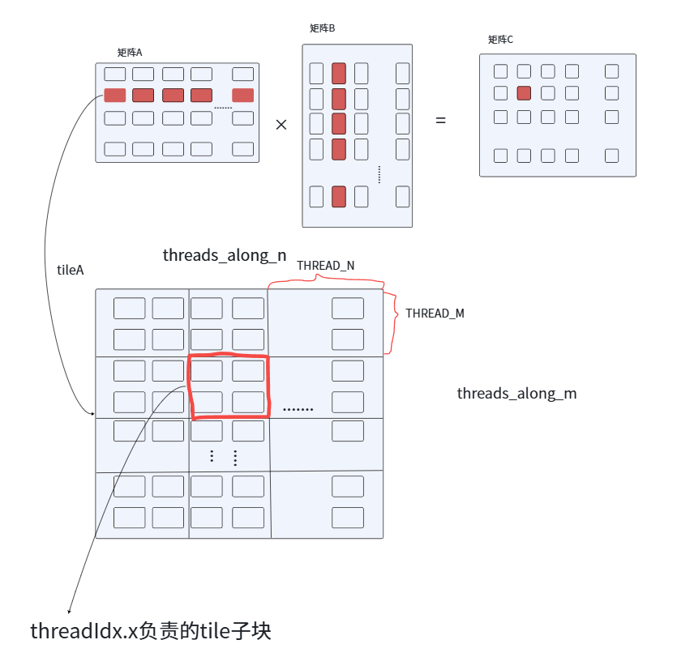
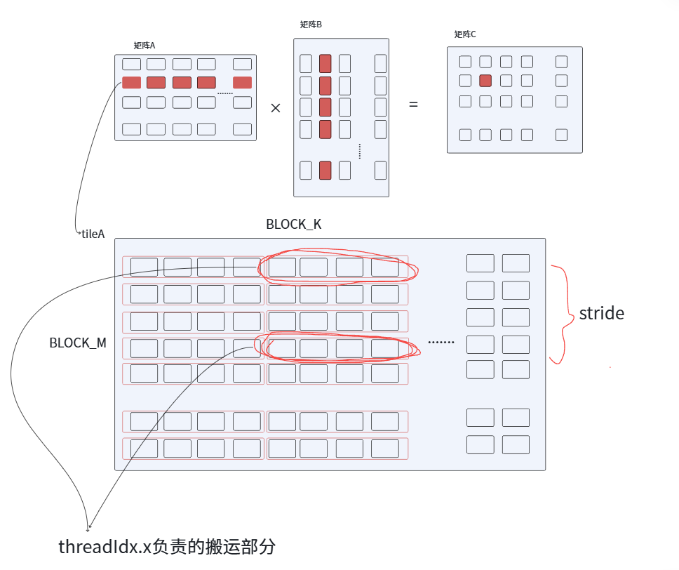
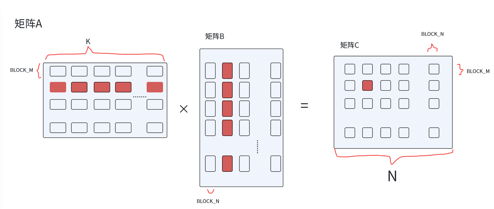
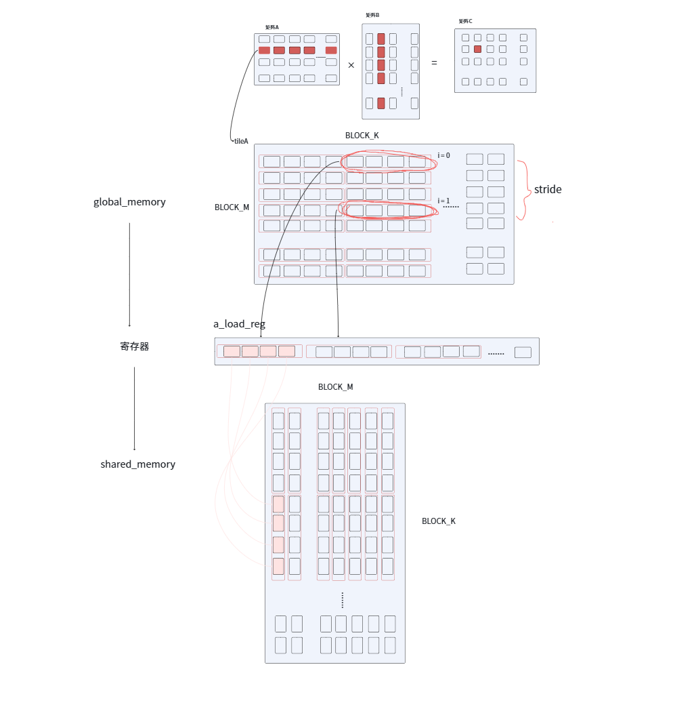
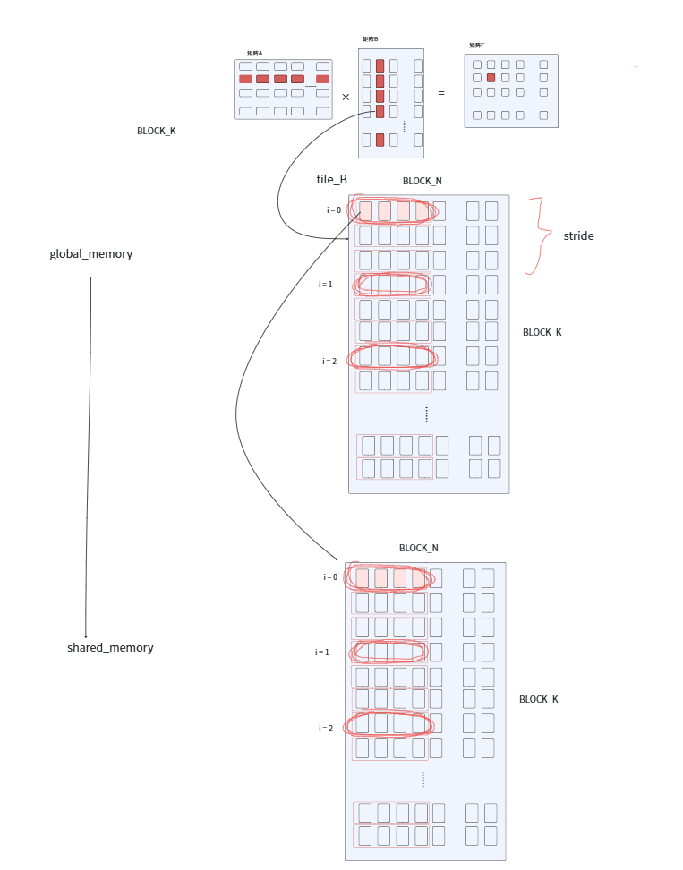
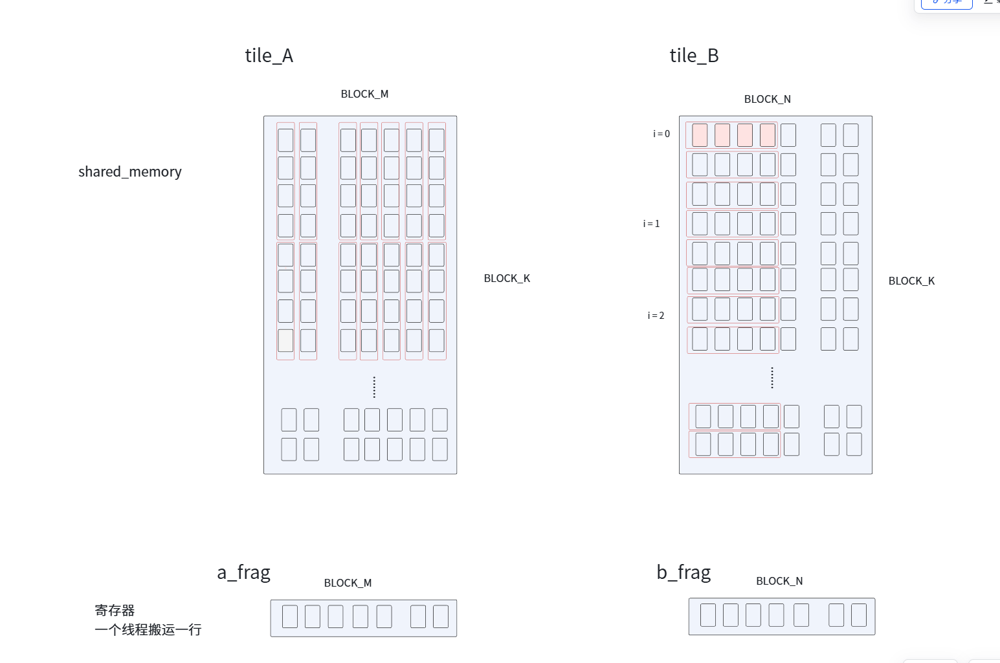

### 讲解

#### 函数参数

```cpp
BLOCK_M、BLOCK_N、BLOCK_K为tile的M、N、K参数
THREAD_M、THREAD_N为单个thread负责的C的tile行数、列数

#define OFFSET(row, col, ld) ((row) * (ld) + (col))                      // 将二维坐标转化为一维
#define FETCH_FLOAT4(pointer) (reinterpret_cast<float4*>(&(pointer))[0]) // 将普通float指针转化为向量
```

#### 函数流程

这里还是一个线程块 block 处理一个 tile，不同的是：一个 thread 不单单处理一个数据，而是处理一部分数据，所以先计算出一个 tile (block) 中需要多少个 thread。一个tile有 `BLOCK_M` 行，`BLOCK_N` 列，而一个thread负责 `THREAD_M` 行，`THREAD_N` 列数据，根据这两个关系就可以得到一个tile需要多少个thread来处理数据。

```cpp
int block_n = blockIdx.x;
int block_m = blockIdx.y;

const int threads_along_n = BLOCK_N / THREAD_N;   // x方向的线程数
const int threads_along_m = BLOCK_M / THREAD_M;   // y方向的线程数
const int threads_per_block = threads_along_n * threads_along_m; // 一个block需要的线程数。
```

得到实际x方向需要 `threads_along_n` 个线程，y方向需要 `threads_along_m` 个线程，所以一个tile一共需要 `threads_per_block = threads_along_n * threads_along_m` 个线程。

每个thread处理数据的位置不同，我们要计算对一个特定的thread要计算的位置。因为一行一共有 `threads_along_n` 个线程，将 `threadIdx.x ÷ 一行的线程数`，向下取整得到这个线程要处理的数据的“行位置”。将 `threadIdx.x 与一行的线程数取模`（相当于最后剩了几个不够一行），得到这个线程要处理的数据的“列位置”。注意，这里的行位置与列位置都是相当于thread来说的。一个thread要处理 `THREAD_M` 行数据，`THREAD_N` 列数据，所以还要在上述结果后分别乘 `THREAD_M`、`THREAD_N` 得到当前子块在block中的位置。

```cpp
int thread_row = (threadIdx.x / threads_along_n) * THREAD_M;
int thread_col = (threadIdx.x % threads_along_n) * THREAD_N;
```



矩阵 A 中一个 tile (block) 中一共有 `BLOCK_M * BLOCK_N` 个数据，一个 tile (block) 中有上面计算出来的 `threads_per_block` 个线程，一个thread一次搬运4个数据，一共需要搬运：

```cpp
const int a_vec_loads = (BLOCK_M * BLOCK_K) / threads_per_block / 4;
const int b_vec_loads = (BLOCK_K * BLOCK_N) / threads_per_block / 4;
```

计算出来thread对应的sub_tile的位置后，还需要知道这个thread要搬运加载数据时在tile中的坐标。一个tile中一行有 `BLOCK_N` 个数据，一个搬运4个，就相当于一行有 `BLOCK_N/4` 个搬运单元，用当前线程 `threadIdx.x ÷ 一行搬运单元的数目`，向下取整，得到对应的“行位置”。用当前线程 `threadIdx.x` 跟一行的搬运数据取余（相当于最后剩了几个不够一行）求出“列位置”，但一个搬运单元有4个数据，所以最后要乘4。B矩阵也是如此。

上面计算过，要把一个tile中的矩阵数据搬运完，每个线程要搬运 `a_vec_loads` 次，我们按x方向上进行搬运，x方向上有 `BLOCK_M` 个数据，用 `BLOCK_M/a_vec_loads` 就求出来一个线程要隔多少步再搬运下一个数据。B矩阵也是如此。

```cpp
int a_load_row = threadIdx.x / (BLOCK_K / 4);
int a_load_col = (threadIdx.x % (BLOCK_K / 4)) * 4;
int a_row_stride = BLOCK_M / a_vec_loads;

int b_load_row = threadIdx.x / (BLOCK_N / 4);
int b_load_col = (threadIdx.x % (BLOCK_N / 4)) * 4;
int b_row_stride = BLOCK_K / b_vec_loads;
```



#### 申请共享内存

```cpp
__shared__ float shared_A[BLOCK_M * BLOCK_K];
__shared__ float shared_B[BLOCK_K * BLOCK_N];
```

前面的计算坐标都是针对tile的，因此要计算tile相对于矩阵的坐标，才能从全局内存中搬运数据。

计算矩阵A中tile的位置时，矩阵A一行有K个元素，一个block对应一行，用 `blockIdx.y * BLOCK_M` 计算出有多少行，两者结合就求出tile在A中的坐标。

计算矩阵B中tile的位置时，一个block对应一列，用 `blockIdx.x * BLOCK_N` 就算出tile在矩阵B的坐标。

计算矩阵C中tile的位置时，矩阵C一行有N个元素，一个block对应一个tile，用 `blockIdx.y * BLOCK_M` 计算出来有多少行，在 ×N 就算出来这些行一共有多少元素，再用 `blockIdx.x * BLOCK_N` 计算出来这个tile前面有多少列。

```cpp
float* block_A = A + block_m * BLOCK_M * K;
float* block_B = B + block_n * BLOCK_N;
float* block_C = C + block_m * BLOCK_M * N + block_n * BLOCK_N;
```



#### 设置寄存器

```cpp
// 线程私有的寄存器
float c_accum[THREAD_M][THREAD_N] = {0.0f};

// 临时寄存器
float a_load_reg[4 * a_vec_loads] = {0.0f}; // 暂存从全局内存读出来的矩阵A数据
float a_frag[THREAD_M];
float b_frag[THREAD_N];
```

搬运数据部分，矩阵A与矩阵B中tile移动的维度大小都是 `BLOCK_K`，每次处理一个tile，所以最外侧循环就是 `for (int k_tile = 0; k_tile < K; k_tile += BLOCK_K)`，后面在一个tile中，每个线程负责搬运自己的那一部分数据。

对于矩阵A来说，一共 `BLOCK_M` 行，每一个线程每次隔 `a_row_stride` 搬一次数据，所以对于矩阵A的数据搬运循环应该为 `for (int i = 0; i < BLOCK_M; i += a_row_stride)`。因为我们是4个float数据一起搬，所以在知道批次（i / a_row_stride）的情况下，还要乘4来得到数据的存放位置 `(i / a_row_stride) * 4`。先从全局内存矩阵A中读取数据，放入临时寄存器 `a_load_reg` 中，再从寄存器中把数据搬运到共享内存 `shared_A` 中。

```cpp
#pragma unroll
for (int k_tile = 0; k_tile < K; k_tile += BLOCK_K) {

    #pragma unroll
    for (int i = 0; i < BLOCK_M; i += a_row_stride) {
        int reg_idx = (i / a_row_stride) * 4;
        FETCH_FLOAT4(a_load_reg[reg_idx]) = FETCH_FLOAT4(block_A[OFFSET(a_load_row + i, a_load_col, K)]);

        shared_A[OFFSET(a_load_col, a_load_row + i, BLOCK_M)] = a_load_reg[reg_idx];
        shared_A[OFFSET(a_load_col + 1, a_load_row + i, BLOCK_M)] = a_load_reg[reg_idx + 1];
        shared_A[OFFSET(a_load_col + 2, a_load_row + i, BLOCK_M)] = a_load_reg[reg_idx + 2];
        shared_A[OFFSET(a_load_col + 3, a_load_row + i, BLOCK_M)] = a_load_reg[reg_idx + 3];
    }

    #pragma unroll
    for (int i = 0; i < BLOCK_K; i += b_row_stride) {
        FETCH_FLOAT4(shared_B[OFFSET(b_load_row + i, b_load_col, BLOCK_N)]) = 
        FETCH_FLOAT4(block_B[OFFSET(b_load_row + i, b_load_col, N)]);
    }

    __syncthreads();

    block_A += BLOCK_K;
    block_B += BLOCK_K * N;

    // 计算部分
    
}
```



在搬运矩阵B的数据时，直接从全局内存搬运到共享内存。



`__syncthreads();` 保证所有的线程在这个tile中的数据搬运完成，后边要搬运下一个tile的数据，需要把 `block_A` 与 `block_B` 相对于矩阵A、B的位置进行更新，tile_A只需要加一个tile的宽度 `BLOCK_K`，而tile_B需要向下移动“一行”，一横有K个数据，一共 `BLOCK_K` 行，所以要加 `BLOCK_K * K`。

此时一个tile中的数据全都搬运到共享内存中了，共享内存 `shared_A` 与 `shared_B` 都是按 `BLOCK_K` 维度进行循环的，所以外侧循环为 `for (int k_inner = 0; k_inner < BLOCK_K; k_inner++)`，在分别从 `shared_A` 与 `shared_B` 中读取数据到各自的寄存器 `a_frag` 与 `b_frag` 中。之后进行矩阵乘法，此时从 `a_frag` 与 `b_frag` 寄存器中每次取一横，相当于 A矩阵的一列xB矩阵的一行，进行矩阵的外积。求出对应的结果。

```cpp
#pragma unroll
for (int k_tile = 0; k_tile < K; k_tile += BLOCK_K) {

    // 数据搬运部分
    
    #pragma unroll
    for (int k_inner = 0; k_inner < BLOCK_K; k_inner++) {

        #pragma unroll
        for (int m = 0; m < THREAD_M; m += 4) {
            FETCH_FLOAT4(a_frag[m]) = FETCH_FLOAT4(shared_A[OFFSET(k_inner, thread_row + m, BLOCK_M)]);
        }

        #pragma unroll
        for (int n = 0; n < THREAD_N; n += 4) {
            FETCH_FLOAT4(b_frag[n]) = FETCH_FLOAT4(shared_B[OFFSET(k_inner, thread_col + n, BLOCK_N)]);
        }

        #pragma unroll
        for (int m = 0; m < THREAD_M; ++m) {
            #pragma unroll
            for(int n = 0; n < THREAD_N; ++n) {
                c_accum[m][n] += a_frag[m] * b_frag[n];
            }
        }
    }

    __syncthreads();
    
}
```



将计算后的结果写回全局内存矩阵C中，先从全局内存中拿出对应的原值，将计算出来的新值进行复制，重新进行复制。

```cpp
#pragma unroll
for (int m = 0; m < THREAD_M; ++m) {
    #pragma unroll
    for (int n = 0; n < THREAD_N; n += 4) {
        float4 c_val = FETCH_FLOAT4(block_C[OFFSET(thread_row + m, thread_col + n, N)]);

        c_val.x = alpha * c_accum[m][n] + beta * c_val.x;
        c_val.y = alpha * c_accum[m][n + 1] + beta * c_val.y;
        c_val.z = alpha * c_accum[m][n + 2] + beta * c_val.z;
        c_val.w = alpha * c_accum[m][n + 3] + beta * c_val.w;

        FETCH_FLOAT4(block_C[OFFSET(thread_row + m, thread_col + n, N)]) = c_val;
    }
}
```