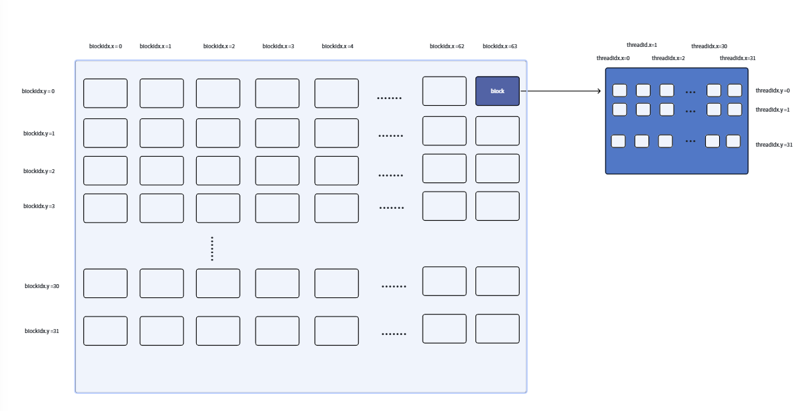
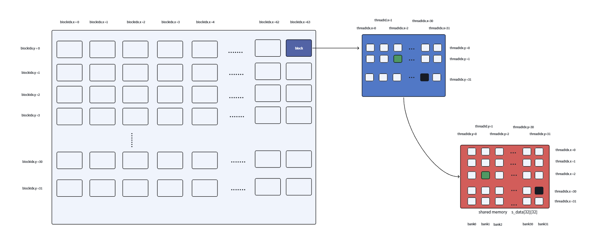
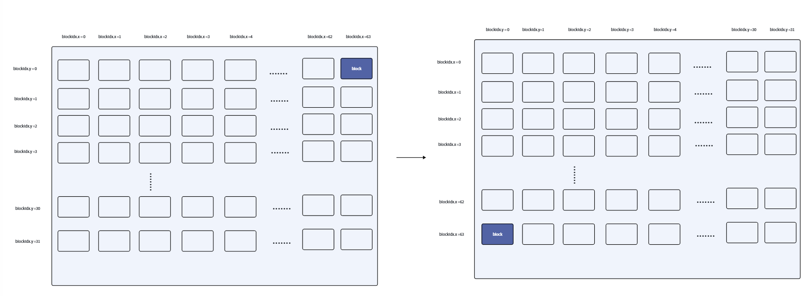

### 矩阵转置

#### Bank conflict

Shared memory 按照 4 个字节一个 bank，一共 32 个 bank，128 个字节。访问这些共享内存会出现 bank conflict 的情况：不同的线程访问同一个 bank 的不同 address 时，就会出现 bank 冲突，并且此时 warp 的状态变为 stall，bank conflict 只出现在同一个 warp 的不同线程之间。

如果多个线程访问相同 bank 的相同 address，实际效果为 broadcast，非 bank conflict。并且 bank conflict 只存在于 shared memory，global memory 不存在。

#### 解决 bank conflict 的方法

1、padding
2、转置存储
3、swizzling机制

#### naive 版本

我们按照下面的参数设置矩阵的行、列以及 grid、block 的大小。

```cpp
const int M = 1024;   // 矩阵行
const int N = 2048;   // 矩阵列
const dim3 block(32, 32);
const dim3 grid((N + 31) / 32, (M + 31) / 32);
```

首先，根据 `blockDim` 与 `blockIdx`、`threadIdx` 计算出一个 block 要处理数据的在整个矩阵中的绝对行与列。并且判断是否超过整个矩阵的范围。

```cpp
int row = blockIdx.y * blockDim.y + threadIdx.y;
int col = blockIdx.x * blockDim.x + threadIdx.x;
```

下面这幅图展示了一个 block 要处理的元素的布局，从图上看能清楚的看到上面的这个绝对地址是怎样得到的。



声明一个共享内存，用来存放这个 block 中从全局内存中读出来的数据，放到共享内存中。矩阵 a 是按行优先存储的，所以从矩阵 a 拿数据时按照 数据所在的行 x 列有多少元素 + 这个元素在第几列 来获取的。

```cpp
__shared__ float s_data[32][32];
if (row < M && col < N) {
    s_data[threadIdx.x][threadIdx.y] = a[row * N + col];
}
__syncthreads();
```

下图为存放共享内存的示意，存入共享内存时，将 `threadIdx.x` 与 `threadIdx.y` 进行了互换，进行了一次转置。同时确保一个 block 中的数据全部写到共享内存中。但在往 shared memory 中写数据时，随着 `threadIdx.x` 的变化，会发生 bank conflict，一直往一个 bank 中写数据。

**(绿色线程为 blockIdx.x=63, blockIdx.y=0, threadIdx.x=2, threadIdx.y=1, row=1, col=2018, a[1][2018]，在共享内存中为 s_data[2][1] )**
**(黑色线程为 blockIdx.x=63, blockIdx.y=0, threadIdx.x=30, threadIdx.y=31, row=31, col=2046, a[31][2046]，在共享内存中为 s_data[30][31] )**



现在写入阶段，要计算绿色线程与黑色线程在矩阵 b 中的绝对位置。

```cpp
int n_col = blockIdx.y * blockDim.y + threadIdx.x;
int n_row = blockIdx.x * blockDim.x + threadIdx.y;
if (n_col < M && n_row < N) {
    // 写入操作
}
```

跟图展示的一样，线程在矩阵 B 中的位置有两部分组成，首先我们计算在矩阵 B 中的行是按 `blockIdx.x * blockDim.x` 计算的。但我们在后面 `+threadIdx.x`，这时一个 warp 中的 32 个线程写入的是同一列的不同行，形成了跨步写。所以为了实现“合并写”，我们让 col 随 `threadIdx.x` 变化，row 随 `threadIdx.y` 变化。



那既然线程输出的位置不能变化，怎样实现转置？这时我们就要让那个位置的线程自己去共享内存中找到转置位置的数据。根据代码的公式，一个线程 `[tx][ty]` 负责写入矩阵 b `[blockIdx.x * blockDim.x + ty]` `[blockIdx.y * blockDim.y + tx]` 的位置，所以需要矩阵 a `[blockIdx.y * blockDim.y + ty]` `[blockIdx.x * blockDim.x + tx]` 的数据（注意，这里根据计算矩阵 a 的绝对位置的代码，`tx` 应该为 `ty`，`ty` 为 `tx`），此时这个数据是由线程 `[ty][tx]` 放到了共享内存 `s_data[ty][tx]` 的位置上，所以只需要执行下面的代码即可：

```cpp
d[n_row * M + n_col] = s_data[threadIdx.y][threadIdx.x];
```

根据这个过程，发现一个线程并不是“从头到尾”负责同一个数据的，前半程线程只负责把 a 矩阵的数据放入共享内存 shared memory 中，后半程从共享内存中拿出另一个数据放入矩阵 b 中。前后管理的数据是不一样的。

---

#### padding

跟前面存在不同只有一点，就是把共享内存改为 `s_data[32][33];`

```cpp
__shared__ float s_data[32][33];

s_data[threadIdx.x][threadIdx.y] = a[row * N + col];   // 往共享内存添加元素
```

在尾部多添加了一个元素，这样相同列的不同行元素就不会出现在同一个 bank 中，避免 bank 冲突。推导如下：

**naive 版本：**
`bankID = (row * 32 + col) % 32 = (threadIdx.x * 32 + threadIdx.y) % 32 = threadIdx.y % 32`。连续 32 个线程的 `bankID` 是一致的，所以会发生 bank 冲突。

**padding 版本：**
`bankID = (row * (32 + 1) + col) % 32 = (row * 32 + row + col) % 32 = (threadIdx.x * 32 + threadIdx.x + threadIdx.y) % 32 = (threadIdx.x + threadIdx.y) % 32`。连续 32 个线程伴随着 `threadIdx.x` 的增加，计算出来的 `bankID` 也不一样，避免了 bank 冲突。

---

#### swizzling

swizzle 机制是在不分配额外内存的情况下，将 shared memory 中的数据进行重排来避免 bank 冲突。

这里引入逻辑位置（数据在矩阵中的坐标）、物理位置（在共享内存中的坐标），在 swizzling 机制中，两者存在一种映射关系：\((x_p, y_p) = f(x_l, y_l)\)。这种映射是一一对应的关系，而异或操作满足这个条件，由于映射前后坐标行不变，将同一行元素的物理位置列坐标异或行坐标，映射后的列坐标也会相互不一样。

```cpp
s_data[threadIdx.x][threadIdx.y ^ threadIdx.x] = a[row * N + col];
```

上面代码中，`s_data[threadIdx.x][threadIdx.y]` 中 `threadIdx.y` 是不变的，会造成 bank 冲突，当将不同的 `threadIdx.x` \(\oplus\) 相同的 `threadIdx.y`，异或的结果不会相互矛盾，因此 `bankID = (threadIdx.x \oplus threadIdx.y) % 32` 也不会相同，避免了 bank 冲突。

```cpp
b[n_row * M + n_col] = s_data[threadIdx.y][threadIdx.x ^ threadIdx.y];
```

从 shared memory 中取数据给矩阵 b 时，本质不需要 `threadIdx.x` 异或 `threadIdx.y` 来避免 bank 冲突，但需要利用异或来保证从正确的位置读取数据。

在写入阶段没有按顺序存，为了避免 bank 冲突，把列坐标与行坐标进行异或，把数据放入 `col=threadIdx.y ^ threadIdx.x` 这一列中。从共享内存中读数据时，必须也要把逻辑列还原出来：

物理列 \(x_p = x_l \oplus y_l = \text{threadIdx.y} \oplus \text{threadIdx.x}\)

还原逻辑列 \(x_l = x_p \oplus y_p\)

又因为映射前后行坐标不变（\(y_p = y_l\)），所以：

还原逻辑列 \(x_l = x_p \oplus y_l = \text{threadIdx.x} \oplus \text{threadIdx.y}\);